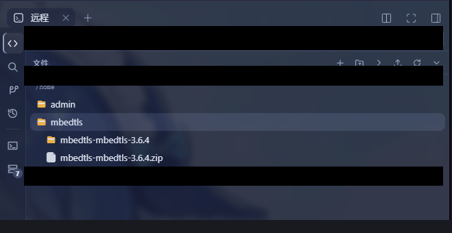
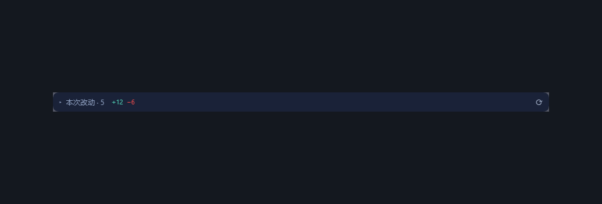

# dsh-remote-vs · VSCode-style remote development for DSH

[](./LICENSE)

[中文](./README.md) | English

SSH host management inside the DSH Host process + helper push pipeline + a **VS Code-style remote
workbench** (explorer / search / source control / commit graph with its commit-details pane / multi-tab editor / floating editor /
side-by-side diff / multiple terminals / port forwarding). Hosts live in DSH Settings ("Remote hosts"); with `dsh-better-sidebar` installed
there is an extra standalone "Remote Workspace" tab, otherwise it falls back to a native right-Sidebar "Remote Workspace"
page (same content, self-opened from the guide, per-session instances). The editor is ALSO mounted into
the conversation view slot as a "远程编辑器" (remote editor) tab next to "对话 / 轨迹", so the code area is
full width; the sidebar copy is the narrow fallback. Since P2, native tools inside remote workspaces
transparently run remotely (see below).

```text
┌─ Local DSH Host ─────────────────────────┐
│  Plugin host half   │  Client half       │
│  hosts/keys/push/   │  settings + native │
│  routing            │  entry takeover    │
│  /api/dsh-remote/*  │  explorer page     │
└─────────────────────┴────────────────────┘
       │ ssh2 (files/proc/terminal) + helper RPC (remote fs)
       ▼
┌─ Remote Linux ─────────────────────────────┐
│  ~/.dsh-helpers/<ver>/<arch>/dsh-ssh-helper│
│  user-chosen remote working directory      │
└────────────────────────────────────────────┘
```

## Install

```sh
dsh plugin --profile web add dsh-remote-vs
```

(From npm, recommended; installing straight from the repository also works:
`dsh plugin --profile web add github:xiray-xia/dsh-remote-vs`.)

**Requires DSH `0.2.2-alpha.3` or newer and below `0.3.0`** (`engines.dsh` enforces the range;
**tested on `0.2.2-alpha.3` and `0.2.2-rc.1`**). On Host `0.2.2-alpha.2` use plugin `0.17.0` (or
upgrade DSH first); the `0.2.1-rc.2` generation needs `0.9.3`. `--profile web` selects which profile to install into —
this is a Web plugin, so it has to go into the profile your Web GUI runs from (`web` is
the common name; use your own profile's name). Desktop uses the reserved `desktop`
profile instead — see [Desktop](#desktop-dsh-desktop) below.

**That one command is all it takes — no build scripts have to be approved.** The package
has no `prepare`/`postinstall` and no package in the dependency tree carries an install
script (`ssh2` is **bundled into the artifact**, not depended on); the repository route
also ships the built `lib/`. The old "allow the printed build scripts in that profile's
`pnpm-workspace.yaml` and re-run" step was pnpm 12's hard policy gate for dependencies
with lifecycle scripts (`ERR_PNPM_GIT_DEP_PREPARE_NOT_ALLOWED` / `ERR_PNPM_IGNORED_BUILDS`);
it cannot be waived from the dependency side, only removed from the tree. Then restart
`dsh web` and open Settings → Remote hosts to configure.

### Desktop (DSH Desktop)

The Desktop app is an Electron shell around the complete dsh Web application, but it runs
in its own reserved profile, `desktop`, managed by the app itself: it does **not** share
`node_modules`, lockfiles, or plugin activation with the `web` profile of `dsh web`, so the
plugin has to be installed once for Desktop too. Sessions, settings, credentials and the
`dsh-remote.json` host configuration under `$DSH_HOME` are shared, so the host list needs
no re-setup.

Install either way:

1. **Desktop's Plugins page**: launch Desktop once → enter `dsh-remote-vs` (a pinned
   version works too) on the Plugins page → install → **fully quit** Desktop (tray Quit /
   application menu exit; the window close button only hides it) and reopen it.
2. **Desktop's bundled dsh command**: application menu → **Manage dsh Command… →
   Install**, fully quit Desktop, run `dsh plugin --profile desktop add dsh-remote-vs`,
   then reopen Desktop.

`desktop` is reserved for the Electron application: an **npm-installed `dsh` cannot manage
it** (it answers `profile "desktop" is managed exclusively by the Electron application`),
so one of the two routes above is required. The Desktop release version equals the DSH
runtime it bundles, and it must satisfy `engines.dsh` (`>=0.2.2-alpha.3`; check About);
older releases make the Plugins page refuse the install. Desktop opens no visible Web
port, but the plugin's HTTP routes and terminal socket are forwarded through Desktop's
Host (the terminal resolves its address from `__DSH_TRANSPORT__.streamBaseUrl`), so no
extra configuration is needed.

> The package carries the prebuilt helper (`vendor/dsh-remote-helpers/`, ~45 MB), so the
> first install is a large download — it is the **only** channel that delivers a helper
> (the official releases ship no helper executable), and dropping it would leave new hosts
> undeployable.

## Capabilities

### Remote workbench (VS Code-style UI)

| Capability | Notes |
| --- | --- |
| Explorer | Lazy tree + one click expands/collapses a directory + hidden-files toggle; **new: a 150 ms hover prefetches** that folder's listing (the expand paints from cache and revalidates in the background; if the prefetch is still in flight, the click waits for it and shows the loading line like a cold directory). On the Host every browse request shares **one long-lived SFTP session**, cutting a listing from two round trips to one (**the first one after a cold start or after the 2 idle minutes still pays the channel open**); context menu: new / rename / delete / copy / move / paste / find in folder / insert `@` reference / **download to local** (files stream to this machine; a directory **or a multi-selection** is archived on the remote host as one `.tar.gz` and streamed, so nothing is buffered in Host memory; a native **Save as** dialog picks the destination when the browser supports it, otherwise the browser's download folder; a bottom-right **download panel** shows live progress, allows cancel, and reports completion/failure; the search-hit menu offers it too; a download ends in one of three honest states — **saved / handed to the browser / failed** — and a hand-off never reads as "done", nor does a Host failure get saved as a file; the tree's empty area has its own context menu (new / upload / paste) and uploads, pastes and drops are **serialized** (a second transfer is refused with an explanation); the tree is keyboard-operable (`↑↓` move, `←→` collapse/expand, `Enter` open, `Shift+F10` menu) and dialogs trap focus and close on `Esc`); git status colours and folder roll-up marks; **type-coloured file and folder icons** (coloured sheet + category mark, amber folders that open, same set as the local sidebar; the tree only — other lists keep the neutral glyph); **drag-hover expand**: while dragging a row or dropping OS files, resting the pointer on a collapsed directory for ~650 ms opens it (spring-loaded folder, so the drop lands inside the folder you just revealed; cancelling the drag leaves nothing half-open) |
| Transfer speed | Uploads/downloads use a **256 KiB × 32 in-flight window** over SSH (pipelined SFTP): single-file downloads and drag-and-drop uploads run ~8× faster than one stream, and the helper push (45 MB) uses parallel `fastPut` too; large uploads are no longer killed by a 60 s deadline (progress watchdog instead). A **download above 4 MiB gets a second dedicated SFTP channel** (one SSH channel caps its window at 2 MiB, so each extra channel adds a window): an interleaved same-process A/B measured **about 1.1–1.4×** (medians of 1.08–1.43× across samples, link-dependent; raw read probes 1.6–1.8× — the product opens two channels, not four); small files keep one channel and one less channel slot, and uploads stay single-channel (the remote write path is the bound, extra channels gain nothing) |
| Search | Two modes: **file names** (remote `find`) and **contents** (remote `grep`). Content mode has a scope folder, `Aa` (case) / `ab_` (whole word) / `.*` (regex), results grouped per file with match highlights, and clicking a hit jumps to that line; **content mode can be aborted** (changing or clearing the query kills the running remote `grep`; an older Host without the streaming route degrades to a one-shot, non-cancellable query), success with stderr warnings is reported above the results, and a **directory** hit in name mode is revealed in the tree instead of being opened as a file |
| Connection status and offline read-only | The top bar and the editor info bar show the current workspace's SSH link state (**connection OK / connection issue / ready, connects on demand**): a drop is no longer silent — open editor tabs keep their cached content and turn **read-only** (saves are blocked with an explanation), the tree keeps showing cached directories while background refreshes stay quiet, and uncached directories say they are offline. When the link recovers, directories, git status, **unmodified file tabs and read-only diff tabs** refresh automatically (tabs with unsaved edits are left alone and the user is told). An errored link is retried at most three times, 30 s apart, then the chip is a manual retry control. While the link is down, "Undo this change" and the diff's hunk actions are blocked too; **a single operation's deadline is NOT treated as a broken link** — the chip stays ok and only that operation fails, with the real reason; when the link is down and the workspace has no cache, the SCM panel says it cannot read instead of sitting on "loading". **No cross-reload persistent cache** (remote source never lands on disk) — a deliberate privacy trade-off |
| Source control | **Repository-folder picker** (for workspaces whose git repository lives in a sub-folder: browse the remote tree, one-click jump to any repository discovered inside the workspace, type a relative or absolute path, and see which repository each folder resolves to); changes / staged / untracked / ignored buckets; **untracked directory rows expand on click**; per-file AND **per-hunk** stage / unstage / discard (behind a confirm) / commit; branches, remotes and stash panes; sync (fetch/pull/push), with **push refspec support** (Gerrit style `HEAD:refs/for/<branch>`; empty = plain `git push`, a non-empty value is remembered); fetch/pull/push/sync get a **live output panel** (server-sent events showing git/remote output, a running clock, **cancel** that kills the remote process group, and the full log for copying afterwards; an older Host without the streaming route falls back to the one-shot result) |
| Session change review | The **collapsible** panel above the composer: what THIS SESSION changed (one row per file, file-type icon, `+a −b` on the right); clicking a file opens it in the remote editor with **line shading plus character-level inline diff**, `n/N ↑↓` jumps between change points, and hovering a changed line offers **Undo this change** (remote `git apply -R`). See "Session change review" below |
| Side-by-side diff | Panes stay **exactly equal** + per-hunk buttons in the middle gutter + a **top horizontal scrollbar** (a very long line can no longer break the symmetry) + pinned line numbers, **rendering only the rows inside the viewport** (a 3000-line file goes from 9000 row containers to ~174, with exactly the same scroll range as a full render); switch between "before / after", and the after side is editable and savable (the save writes the working-tree file back; a diff above 8MiB is read-only, so a truncated prefix can never be written over the real file) |
| Commit graph | SVG branch/merge graph; selecting a commit opens the **resizable / expandable commit-details pane** below it with three views: **Commit details** (subject, author, time, full hash + copy, parents, refs, message body, checkout), **Contents** (changed files grouped by directory, collapsible and path-filterable; click for the diff, right-click or the row button to open in the editor), **Diff** (only the first ~1500 rows start expanded, later files start folded; both line numbers, `+/−` counts, line wrapping, previous/next-file navigation, and copy of one file's patch or the whole patch). Merge commits are shown against their **first parent** (git lists no files for a merge otherwise) |
| AI review | A single-file diff OR a **whole commit** can be handed to the conversation with one click — the request is **appended to the composer draft only** (nothing is sent automatically, and you can edit it first): a diff up to 32 KiB is inlined verbatim; a larger one (or one silently truncated at the 2 MB cap) becomes a summary request — file/commit facts + hunk headers + "fetch it yourself with `git show`" (a 2 MB diff is hundreds of thousands of tokens, so inlining it is pointless); an untracked or binary file is passed by path and the model reads it. Entries: the side-by-side diff toolbar and the commit pane's Diff toolbar; the button is disabled with the reason when the current session is not bound to this remote workspace, or the host exposes no conversation input channel |
| Multi-tab editor | Open/save/reload, dirty marks, several files at once; **saves are atomic** (side file + rename, writing through symlinks and keeping the mode bits); **a save is checked against the remote baseline** — when the file was written by someone else (an agent through the transparent route, a terminal, another editor) since it was opened, the save is refused and offers "overwrite / load remote version / show difference" instead of overwriting silently; image preview, Markdown/HTML preview (source vs preview); closing a tab, reloading and switching workspace all **ask first** when there are unsaved edits (a workspace switch clears every tab, so it asks); `Ctrl+S` works globally, even when the editor is not focused; **a page reload reopens the file tabs you had** (per workspace, at most 12; paths only, never contents; tabs that no longer open are skipped and counted; caret and scroll position are not restored) |
| Floating editor | Three entries: "Open in floating editor" in the file-tree / search-hit / source-control context menus, plus **double-clicking the "remote editor" tab** to float the editor as it stands (same tabs, previews, diff, find and change marks — not a second, thinner editor). Drag the title bar to move, drag any of the eight edges/corners to resize, maximize/restore (or double-click the title bar); **minimize to a draggable floating ball** (dirty dot on it, click or press Enter to restore, drag to park it anywhere); `Ctrl+wheel` zooms the editor text. Position, size, font size and the ball's spot survive a page refresh |
| Syntax highlighting | VS Code **Dark+ / Light+** palettes; covers java/aidl/smali, c/c++, go, rust, js/ts, json, py, yaml, xml, html/css, md, sh, properties/rc/toml, diff …; a **fallback colorer** takes over when no grammar matches, so a file is never left monochrome. Honest caveat: kotlin / gradle / smali are coloured by the Java grammar (no dedicated package), which gets keywords, strings and comments right but does not split their own syntax |
| Find | In-editor `Ctrl+F` (`Aa` / `ab_` / `.*`, `3/17` count, ↑↓, `F3`/`Shift+F3`, `Esc`); **selected text is carried into the box by `Ctrl+F`**; the widget is pinned to the top-right and does not scroll away; the `n/N` count refreshes on `F3`, clicks and caret moves |
| Quick open | `Ctrl+P` (`⌘+P` on macOS) jumps to a file by name instead of expanding directories one level at a time: the remote file index is fetched once (`rg --files` when available, `find` otherwise; **both caps are enforced on the remote side**, and a truncated listing says so — "index truncated, only the first N files are searchable" — instead of pretending to be complete), filtered locally by a subsequence scorer (consecutive matches, the file-name segment and word boundaries carry weight; ties break on path order so the list never reshuffles). The first screen is your recently opened files. The index lives **in memory only**, stores paths and never contents, and is rebuilt after a save/upload/delete/rename/create; writes made by a terminal or an agent bypass that and come back on a page reload. The shortcut only takes over while the remote workbench is visible — a local chat page keeps the browser's own `Ctrl+P` |
| Jump | Clicking a search hit opens the file at that line, centres it and **lights the landing line** (fades after ~2.6s); repeat jumps in the same file work |
| Terminals | Tabbed multi-terminal (`+` to create, `✕`/middle-click to close behind a confirm), across hosts; session ids are persisted so a page refresh reattaches to the running shells, and a session is kept for **10 minutes after its last socket goes away** (enough for a refresh or a browser-tab switch) before the remote shell is closed; **a socket drop (as opposed to a shell exit) keeps the session and offers a one-click reattach** (the same session id reattaches, and the Host still reclaims it after the 10-minute TTL above), and only a real exit clears it |
| Workspaces | Binding list + routing-mode dropdown + the dual-mode (local / remote) new-workspace wizard; **unbinding asks first** (sessions and history stay readable, new remote calls are refused) |
| Port forwarding | A sidebar **"Ports"** page: lists the remote host's listening TCP ports (`ss`, falling back to `netstat`) and forwards any of them to a local port in one click, with the local URL for copying/opening. Manual rules ("remote address:port → local port, which may be auto-assigned") are supported too. **The local listener binds `127.0.0.1` only** (`ssh -L` semantics — never exposed to the LAN); each rule has its own channel budget and never consumes one of the six exec/SFTP slots. An SSH drop or the idle eviction does not kill the listener: the next local connection simply re-dials. Rules live in the browser (restored after a reload) and every one can be stopped; disabling the plugin, deleting the host, or unloading it releases the local ports. When the remote has neither `ss` nor `netstat`, or the probe times out or is interrupted, the panel says "cannot enumerate" instead of showing an empty list |

### Hosts and transport

| Capability | Notes |
| --- | --- |
| Host management | CRUD + connectivity test; key / password auth; config in `$DSH_HOME/dsh-remote.json` (0600), independent from `dsh-ssh.json` |
| Key bootstrap | One click generates a dedicated keypair on password hosts and deploys `authorized_keys`, key auth from then on |
| Push pipeline | Remote arch/OS probe → version compare → skip-if-same / else push; the executable channel pushes a self-built helper. A failed deploy no longer retries on every remote file operation: it backs off from **5 seconds up to 5 minutes**, and the Settings "Push" button forces an immediate retry |
| Remote files | SFTP browse / read / write / create / delete / rename. Boundaries hardened: 0-byte files no longer deadlock, and every SFTP operation times out at 60s and releases its channel; **a single directory listing is capped at 20000 entries** (the first 20000 after sorting — directories first, then names — announced in the host log; the protocol carries no "truncated" field, so the UI has no marker); **a save goes through a side file and a rename** (server-side `posix-rename` when available, otherwise backup-rename-rollback), **writes through symlinks** (the link itself survives) and keeps the mode bits **on a best-effort basis**; SCM status parsing unquotes git's C-quoted paths (any name with whitespace is quoted) |
| Remote terminal | ssh2 PTY + WebSocket, xterm rendering (copy-paste/theme-follow/reconnect-on-refresh); **a reattach only takes over, it does not resize** (a page reload no longer shrinks a running shell to 80×24); an output backlog applies real backpressure to the far end; **frames are capped at 1 MiB**, and pastes past 64 Ki characters are chunked on code points by the client instead of dropping the connection |
| Concurrent channels | At most **6** remote channels per host at a time (no longer colliding with the far end's sshd `MaxSessions`); the 7th queues for up to **30 seconds** and then fails with `remote host <alias> is busy` instead of piling on connections |
| Monitor | A sidebar **"Monitor"** page samples one host or every host **only while the panel and the page are visible**, at the configured refresh interval (5 s by default; 5/10/30 s in its settings): CPU, memory, disk, load, network rate, temperature and uptime, with 60-point history curves plus manual refresh and pause. The scope is "current host / a named host / all hosts" and survives a reload. The **first sample reports CPU% and the network rate as unknown** (both are deltas and need a second sample), and a non-Linux host shows unknown instead of 0. The Host caches one sample per alias for 3 seconds and joins concurrent requests, so one sample uses one exec channel and never the port-forward budget. Samples live in memory only — nothing is written to disk |
| Timeouts and process cleanup | Ordinary git commands default to 300 s (configurable); the **network verbs (fetch/pull/push/sync) default to 20 minutes with a 30-minute ceiling**. exec runs in its own session (`setsid --wait`); on timeout OR cancel it sends TERM and **escalates to KILL after 3 seconds**, reaping the child processes with it; a host without `setsid --wait` is detected by a one-shot probe and falls back to the old behaviour, with a host-log line saying the timed-out remote command may still be running; **directory / multi-selection archive downloads carry a 600 s server-side budget** (remote `timeout -k 3 600`; a host without GNU `timeout` falls back to the unbudgeted old behaviour) and fail with the real reason when it expires |
| Git graph | Remote repo status + branches + SVG commit graph + commit details/contents/diff pane (exec + frontend parsing, zero Host additions) |
| Import | One-click import from `~/.ssh/config` and from an existing `dsh-ssh.json` (read once, no coupling); `Host a b` multi-pattern entries are expanded one by one, `Include` is reported as not expanded instead of being silently dropped, and every skipped host names an actionable reason (no User / no IdentityFile / invalid port …) |
| Environment check | An "environment check" per host: one remote command probes OS/kernel, glibc, `git`, `ripgrep`, `tar`, `setsid --wait`, `$HOME` free space, CPU/memory, the deployed helper version and sshd's `MaxSessions`, shown as a three-state table (**available / missing / unknown**). "Could not determine" is reported as **unknown**, never as "missing" (insufficient permission, unparseable output and a dropped link are all unknown); every row keeps the remote's own words, stderr is merged rather than discarded, and the whole report copies in one click |

### Agent capabilities

| Capability | Notes |
| --- | --- |
| Agent tools | `remote_hosts` / `remote_exec` / `remote_read` / `remote_write` / `remote_ls` |
| **P2 transparent remote execution** | Native `read/write/edit/bash/glob/grep/jobs` inside remote workspaces run directly on the far end |
| **P3 remote @ references** | `@` in remote sessions completes remote files (fileReferences router: scoped live listings / bare queries via a remote rg index) |

## Project structure

```text
dsh_remote_vs/
├── cordis.patch.yml        # composition: plugin row + private local realm + routers + preset-remote
├── src/
│   ├── index.ts            # plugin entry: store/pool/worlds/routes/tools/preset-switch wiring
│   ├── protocol.ts         # frontend/backend wire contract (route table + pure types, shared)
│   ├── paths.ts            # four-piece addressing under $DSH_HOME (store/keys/build cache/alias dirs)
│   ├── store.ts            # host + binding + tombstone persistence (0600 JSON, atomic writes)
│   ├── pool.ts             # ssh2 long-lived pool (exec/shell/sftp/putFile, TOFU host keys)
│   ├── sftp.ts             # remote file engine (SFTP windowed reads-writes/tree ops)
│   ├── keygen.ts           # password-host key bootstrap (generate→deploy→flip)
│   ├── deploy.ts           # push pipeline (probe/compare/ship/double-verify/manifest)
│   ├── importers.ts        # ssh_config / dsh-ssh.json parsing importers
│   ├── routes.ts           # /api/dsh-remote/* route table + terminal WebSocket upgrade
│   ├── terminal.ts         # PTY session registry (reconnect-on-refresh/disconnect cleanup)
│   ├── forward.ts          # local port-forward manager (direct-tcpip channels / one listener per rule / budgets)
│   ├── listen-ports.ts     # remote listening-port probe (ss/netstat command + pure parser)
│   ├── metrics.ts          # host-monitor probe (one POSIX /proc command + pure parse/CPU·net deltas)
│   ├── monitor.ts          # monitor sampler (per-alias TTL cache/in-flight join/counters/forget)
│   ├── tools.ts            # the 5 Agent tool definitions
│   ├── http.ts / loopback.ts # JSON body IO + loopback trust fence
│   ├── git-format.ts       # git command builders + pure frontend parsing (zero Host additions)
│   ├── git-ops.ts          # the full remote git surface: status/diff/branch/remote/stash/commit/hunk patch builders + parsers
│   ├── fs-ops.ts           # remote file-operation command builders (copy/move/remove/stat)
│   ├── search-ops.ts       # remote content search (grep builder + NUL-separated parser + match splitting)
│   ├── p2/                 # ── P2 transparent routing ──
│   │   ├── worlds.ts       # world decisions (cwd key/alias/tombstones) + remote RPC/FS/proc contexts
│   │   ├── helper-rpc.ts   # helper wire protocol over an ssh2 exec channel (handshake/heartbeat)
│   │   ├── router-fs.ts    # transparent fs router (target→world map/path translation/policy rewrite)
│   │   ├── router-subprocess.ts # transparent process router (argv0 reduction/pwsh gate)
│   │   ├── ssh-proc.ts     # ssh2 process runtime (setsid group kill/marker/stdin/spill)
│   │   ├── shell-bash.ts   # routed bash executor (local verbatim/remote strips DSH_*)
│   │   ├── router-spill.ts # transparent spill router (session world key/remote dir)
│   │   ├── router-refs.ts  # transparent @ reference router (agent world key, P3)
│   │   ├── file-refs.ts    # remote @ search (live fs-ssh listings/rg index/ported stock scoring)
│   │   ├── bridge.ts       # private-realm local publishes (localFs and other early services)
│   │   └── bridge-refs.ts  # standalone refs bridge (local-refs needs workingDirectory: must split)
│   └── client/             # ── browser half (React, bundled into lib/client.js) ──
│       ├── index.tsx       # surface decision (better-first/settle-boost/native fallback) + settings + directoryFlow takeover
│       ├── store.tsx       # module-level state shared by both surfaces (useSyncExternalStore; open files/terminals/view live here)
│       ├── RemoteRoot.tsx  # sidebar surface: VS Code activity rail (explorer/search/SCM/history/editor/terminal/workspaces)
│       ├── RemoteEditorView.tsx # conversation-view surface (the "remote editor" tab next to 对话/轨迹, full width)
│       ├── RemoteExplorer.tsx   # explorer: tree + context menu + file ops + @ references + status marks
│       ├── drag-expand.ts       # drag-hover auto-expand (pure state machine, shared by both drag paths)
│       ├── SearchView.tsx       # search panel: name / content modes + Aa/ab_/.* + grouped hits + jump
│       ├── EditorPane.tsx       # editor pane: tabs + info bar (build stamp / tok count) + image/MD/HTML preview
│       ├── FloatingEditorWindow.tsx # floating window frame (title-bar drag/8-way resize/maximize/ball minimize/font zoom)
│       ├── float-tab-trigger.ts     # double-click on the "remote editor" tab (the tab row is the host's, so label-based)
│       ├── FloatingPlaceholder.tsx  # "docked elsewhere" placeholder + dock button left on the other surfaces
│       ├── float-editor.ts      # window geometry/resize/surface rules (pure; driven directly by the self-check)
│       ├── live-editor.ts       # live buffer + scroll/caret handoff across a surface change
│       ├── CodeEditor.tsx       # CodeMirror wrapper: grammar table/theme/find widget/jump/fallback wiring
│       ├── scm/            # ── source control ──
│       │   ├── ScmPanel.tsx     # changes/staged/untracked + per-file and per-hunk actions + commit box
│       │   ├── DiffView.tsx     # side-by-side diff (top scrollbar/hunk buttons/editable after side)
│       │   ├── HistoryPanel.tsx # SVG commit graph + resizable/expandable commit-details pane
│       │   ├── CommitPane.tsx   # details/contents/diff tabs + patch toolbar + context menus
│       │   ├── commit-model.ts # patch blocks/line numbers/counts/directory grouping/file stepping (pure)
│       │   ├── actions.ts       # remote git action layer (over the exec channel)
│       │   ├── diff-model.ts    # unified diff → side-by-side row projection (pure)
│       │   └── status-map.ts    # status bucketing + tree marks (pure)
│       ├── vsc/            # ── VS Code skin and controls (zero new runtime deps) ──
│       │   ├── kit.tsx / vsc.css    # icons/dialogs/context menu/segmented control + all styles (scoped to .rvs-root)
│       │   ├── editor-palette.ts    # Dark+/Light+ palette + fixed class names (rvs-ck-*)
│       │   ├── editor-theme.ts      # editor chrome theme (live light/dark swap)
│       │   ├── editor-langs.ts      # file extension → CodeMirror grammar
│       │   ├── fallback-highlight.ts# coloring used when no grammar matched (via tokenize.ts)
│       │   ├── FindWidget.tsx       # Ctrl+F find widget (pinned top-right)
│       │   ├── reveal-line.ts       # jump + landing-line highlight
│       │   ├── tokenize.ts / markdown.tsx # read-only pane tokenizer / dependency-free markdown renderer
│       ├── NativeExplorer.tsx# native page type definition + seat body (no-sidebar fallback)
│       ├── composer.ts / use-remote-chat-target.ts / selection-popup.ts # remote @refs/selection-to-chat
│       ├── ai-review.ts    # AI review prompt builder (single diff / whole commit, byte tiers, pure)
│       ├── api.ts          # typed fetch wrapper over /api/dsh-remote
│       ├── MonitorView.tsx # monitor panel (one/all hosts, curves, pause/refresh, persisted scope)
│       ├── metrics-model.ts # monitor model (history window/sparkline geometry/capacity+rate formatting)
│       ├── HostsView / WorkspacesView / WorkspaceWizard / TerminalView / XTerm / PortsView / Dialog
│       ├── SettingsHosts.tsx        # settings occupants (host mgmt/binding list, self-fetching)
│       ├── DirectoryFlow.tsx        # native entry occupant (local dual-mode/remote wizard)
│       ├── RemoteDirectoryPicker.tsx# remote directory browser dialog
│       └── i18n.ts / theme.ts / ui.tsx # bilingual dictionary/theme signal/shared styles
├── vendor/dsh-remote-helpers/ # helper seeds (shipped, seeded into cache at startup, see below)
├── docs/                   # local-only working docs (only docs/media/ screenshots ship)
│   ├── MAINTENANCE.md      # local-only (.gitignore), not shipped: upgrade impact, checklist, pitfalls, release
│   ├── VERSION-HISTORY.md  # local-only: per-release change log (0.7.1 → 0.20.0)
│   └── GATES.md            # local-only: local gate inventory and measured assertion counts
├── locale/                 # bilingual plugin metadata
└── lib/                    # build output (**must be committed**; only .map is ignored; restart after link install)
```

`vendor/dsh-remote-helpers/` (committed) holds helper seeds: at startup the plugin spreads them into
`$DSH_HOME/dsh-remote-helpers/` (copy-if-absent, never overwrites), so fresh installs can push right away.
When a new helper is built, swap the 4-piece set (tarball + sha256 + helper.json + patch notes)
into vendor and commit (details live in the local-only `docs/MAINTENANCE.md` §4, which is gitignored and not distributed).

`.spike/` and `scripts/` (both gitignored, **never distributed with the repository**) hold the
development-time verification and self-check scripts: `.spike/` has the live-host ones — `p2-router.ts`
main regression (real remote + real Cordis + real router classes) and probes like `grep-probe.mjs`
(build with the local `tsconfig.scratch.json`), plus `model-check.mjs` / `reveal-check.mjs` /
`fallback-check.mjs` / `client-load-check.mjs` / `tool-schema-check.mjs` which need no host at all;
`scripts/` has the plain-node regression gates (`node scripts/check-*.mjs`, with `verify-lib.mjs`
checking the build artifact). Both are covered under "Development".

## Remote workbench (VS Code style)



Both surfaces share one state module (`store.tsx`): **the sidebar "Remote Workspace" page** (a standalone tab when
`dsh-better-sidebar` is installed, otherwise the native right-Sidebar page) and **the conversation-view
"remote editor" tab** (next to 对话/轨迹, giving the code area full width).

- **Activity rail**: explorer / search / source control / commit graph / editor / terminal / workspaces.
  A panel stays mounted after its first visit, so switching back neither refetches nor flashes. While it is
  hidden it does **no remote work** (directory listings, the SCM stash/branch/remote queries and editor
  image reads all wait for the next foreground pass), and visibility is MEASURED on the plugin root
  (IntersectionObserver) instead of being taken from a host prop.
- **No blank wait when switching workspaces**: the last git state read for each (workspace, repository
  directory) is kept in memory, so switching back paints the change list, branch and tree marks **in the
  same frame** and re-reads behind it. The panel says "cached · refreshing" meanwhile; the change list and
  the stage/commit/discard buttons still act on that workspace (⟳ and "reset repository directory" are
  disabled while the background read runs — pressing them would only queue a second walk of the same tree).
  One git read per repository DIRECTORY at a time (changing the directory lets the two directories' reads run
  side by side — they are two different walks); a manual refresh's answer is always post-click (it queues
  after the running read); a read of a workspace you left behind only fills its own cache and never repaints;
  a failed background read keeps the list and shows why instead of declaring the workspace "not a
  repository". The first visit to a workspace still waits — cache cannot invent a read.
- **Editor**: tabs plus an info bar (path, language, **build stamp**, `tok N` coloured-token count,
  saved state, reload/save). Those three marks exist for troubleshooting: the stamp answers "is the
  browser running the bundle I just built?", `tok 0` answers "did a grammar match this extension?".
- **Floating editor**: "Open in floating editor" from the file-tree / search-hit / source-control context
  menus, or double-click the "remote editor" tab, lifts the editor into a window above the shell (same tabs
  and buffers; closing or docking puts it back on its original surface). Drag the title bar, resize from the
  eight edges/corners, maximize/restore; **minimize to a 44px floating ball** (no full-width bar — park it in
  any corner, click/Enter restores it, and it shows a dot while there are unsaved edits); zoom the text with
  `Ctrl+wheel`; unsaved text is explicitly handed over between the main surface, the floating window and tab
  switches (the disk-side baseline is kept separately, so the dirty mark can never be mistaken for saved).
- **Find and jump**: `Ctrl+F` opens a widget pinned to the editor's top-right corner
  (`position: fixed` anchored to the editor's rect, so no ancestor scroller can carry it away);
  a selection is carried into it by `Ctrl+F`; a jump from the search results centres the line and
  lights it up.
- **Terminals**: tabbed sessions with the session id persisted one by one, so a page refresh reattaches
  to the shells that are still running; **a reattach only takes over, it does not resize** (a live shell is
  never shrunk to 80×24 — the true size comes from the one tab that can measure itself, sent as a `resize`
  frame); a session is kept for **10 minutes** after its last socket goes away before the remote shell is
  closed (it used to be kept forever, so closing the browser left the shell holding an sshd session slot).
- **Known limits (stated honestly)**:
  - There is **no public API to select the "remote editor" view**; the plugin can only click the shell's
    own tab by its label and toasts a hint when that fails (`revealEditor()`).
  - Untracked directories arrive as a **single `dir/` row**; clicking it **expands** the files inside
    (one path-limited `git status -uall -- dir/`, so the cost tracks the directory, not the repository;
    click again to collapse). An expansion is a snapshot of the moment it was opened — collapse and
    re-expand to refresh it.
  - Opening a file is capped at 8MiB (official helper constant); beyond that it is shown read-only, and the diff's after-side is read-only for such files too (a truncated prefix is never written back).
  - A save checks the remote baseline it was opened from (mtime and size): if the file was written by someone else in the meantime (an agent through the transparent route, a terminal, another editor) the save is **refused** and offers "overwrite / load remote version / show difference" instead of silently replacing their work. This **narrows** the race rather than closing it: SFTP reports mtime in whole seconds, so a same-second change of the same length is still undetectable, and a window remains between the check and the moment the bytes land: a save writes a side file and then atomically renames it, so a write by someone else during that window (seconds for a large file) is still overwritten — the difference is going from "blind whole-file write" to "a much smaller window". Programmatic writes (agent tools, helper push, deploy manifest) carry no baseline and behave exactly as before.
  - The find widget floats above the code (like VS Code) and takes no layout space.
  - Output backpressure is **per shell**: one tab that cannot keep up pauses every tab attached to that
    shell — a deliberate trade, preferring to hold the remote command back on behalf of the slowest
    consumer over letting host memory grow without bound.
  - A directory listing past 20000 entries is truncated, and since the protocol has no "truncated" field
    the UI shows **no marker at all** — only the host log line
    `listing <path> on <alias> shows 20000 of N entries`.
    - **Monitor limits**: sampling happens only while the Monitor panel is the visible view AND the page is
      in the foreground (hidden means zero remote traffic); the complete metric set comes from Linux
      `/proc`, so other platforms show unknown; temperature exists only when the host exposes a thermal
      zone (many VMs do not); CPU% and the network rate are deltas, so the **first frame is unknown**;
      samples live in memory only and the curves restart after a page reload.

## Session change review (Cursor style)



The **collapsible** panel above the composer (titled "本次改动") answers, per **session**, "what did this turn
change?". Its data comes from the plugin's own change ledger (`/api/dsh-remote/changes`), not from DSH's
`workspaceChanges` — the latter cannot see a routed session at all (the probe measured 58 remote sessions
with zero change events).

- **The panel**: one row per file (file-type icon + relative path + `+a −b` on the right), aligned left and
  right with the composer card; click the header to collapse/expand, `⟳` forces an immediate rescan. With no
  changes it says "this session has not changed any file yet"; when it cannot compute, it states the
  **specific reason** (see the limits below) instead of handing you an empty list to guess about.
- **Clicking a file** opens it in the remote editor with change marks: added lines get a **green line
  background**, deleted characters are drawn as an **inline struck-through chip** (a deleted character does
  not exist in the new file, so it can only be an inserted widget), and the left gutter carries a change bar.
- **Jumping between change points**: the floating `n/N ↑↓` control at the editor's top-right
  (`Alt+Shift+Cmd/Ctrl+↓/↑`) cycles through them; typing in the editor invalidates the marks and says
  "position may be out of date".
- **Undo this change**: hover a changed line and click → remote `git apply -R`. When the context no longer
  matches, the far end refuses outright (not one byte of the file changes); a tab with unsaved edits is
  refused first, so a remote patch can never overwrite your buffer; on success the caret stays where it was
  and the marks are re-read (they do not simply vanish because something was undone).
- **Follow the session's workspace**: the sidebar, the editor's dropdown and the file tree all follow the
  workspace the **current session** lives in; after a manual switch they are not pulled back within that
  session, and a new session follows again. The capability lives in the store, so it works even when **the
  sidebar was never opened**; clicking a changed file is "show me this result", not a manual switch.
- **Repository directory**: the one the user picked under Source control → repository directory always wins;
  when the session root is not a repository, a single candidate one level below is adopted automatically,
  while several candidates produce an explicit hint to set it in Source control.

**Known limits (stated honestly)**:

- The baseline is the **session start**, not HEAD: untracked files that already existed before the session
  began are not counted as this session's work.
- Tracked files refresh when a **turn ends** (the panel polls every 3 seconds as a backstop, so the numbers
  usually catch up within a second or two); **new files** created in a shell are found by a **slow scan**
  whose single-run budget is up to **3 minutes**, re-run at a self-tuning interval (at least 5 seconds,
  naturally longer on a huge checkout). `⟳` forces an immediate rescan.
- A non-git workspace, or one holding several repositories with no repository directory set, shows the exact
  reason (`no git repository at the workspace root, and N candidates below it — set the repository directory
  in Source Control`) rather than an empty list.
- Binary and oversized files are marked "binary / too large" on the row and get no character-level diff;
  **non-UTF-8 text (GBK and friends) is treated as binary** (no counts, no undo) so it cannot produce
  garbage numbers and an undo that always fails.
- When the untracked scan gives up (e.g. the far end refuses), the panel **states the reason** and keeps the
  refresh entry point instead of silently listing fewer rows.
- Undo carries **provenance** (session / binding / repository directory), so a patch can never be applied to
  another host after switching sessions or bindings; a file this session created whole is not offered for
  undo (a reverse patch must never delete an untracked file).

## P2 transparent remote execution (Windows native)

Single-Host mixed routing: native tools dispatch by which world the session cwd lands in — remote aliases go
over helper RPC (fs) / ssh2 (processes), local stays untouched; both share one Host and one GUI.

- Alias dirs: `$DSH_HOME/remote-ssh/aliases/<id>` (empty shells, routing keys only), auto-registered into the native workspace list as `<server> > <base>`
- Routing switch (dropdown at the top of Settings → Remote hosts; underneath it is profile patch `- id: remote-vs`, `config.routingMode`, volatile, no restart):
  default `enforce` (real routing); switch to `off` (pure local passthrough) / `shadow` (logs, still local) as debugging escapes
- New workspace: the native "Add workspace…" entry is adopted (local/remote dual tab; remote leg = host→push→bind wizard)
- Presets: a `Remote` preset (bash toolset); under enforce, new remote sessions switch to it automatically (default preset only, never overrides an explicit choice)
- Ground truths (measured, not assumed):
  - Remote `grep/glob` call remote `rg` through routing (both measured hosts ship rg 13; no remote rg means no hits)
  - Whole reads >8MiB report `FS_TOO_LARGE` (official helper ceiling) — use streaming/paged reads; **writes are uncapped** (a 46MiB whole write passed live)
  - Oversized process output lands in a Host temp spill file (`readFrom` returns tail + path, full text lives in the file — same as stock)
  - After unbinding, new calls are explicitly refused (fail-closed tombstones), history stays readable
  - Disconnects: in-flight calls are not replayed; new calls reconnect automatically; the link state is shown explicitly in the top bar / editor info bar, and while it is down the editor and cached directories stay **read-only visible** (see "Connection status and offline read-only")
- Verify: `npx tsc -p tsconfig.scratch.json && node .spike/build/.spike/p2-router.js`
  (real remote + real Cordis + real router classes, 61/61; P0 routing and GUI need a Host restart + smoke pass)
- Details: the local-only `docs/MAINTENANCE.md` (§2 coupling points, §3 checklist)

## Self-built helper (P1)

Upstream never published helper binaries (all Release assets are empty), so this plugin builds its own:

- Build machine: WSL2 Ubuntu-22.04 (glibc 2.35, matching the remote targets), Node v24.21.0 + pnpm 11.28.5
- Sources: the `dsh-v0.2.1-alpha.2` tag (the **build baseline**: what must match is the wire protocol version, not the Host version — our protocol is still **2**, so a Host upgrade to `0.2.2-alpha.3` needs no rebuild either: the plugin intentionally stays on `dsh-ssh@0.2.1-rc.2`, and the new generation's protocol 3 is deliberately not followed — see §2.26 of the maintenance notes)
- Command: stock script `pnpm exec tsx scripts/build-exe-for-ssh-helper.ts --target=node24-linux-x64`
- Only deviation: no docker for the manylinux 2.28 rebuild, so a `DSH_GLIBC_CEILING`
  env override was added (default stays 2.28); this build targets 2.35 (see `glibc-ceiling.patch` in the cache dir)
- Checks: stock `verify-ssh-helper-artifact.ts --sandbox=required`, all 8 green
- Cache: `$DSH_HOME/dsh-remote-helpers/` (`*.tar.gz` + `.sha256` + `.helper.json`
  with binarySha256, feeding P2's helperHash)
- Full rebuild procedure for upgrades: the local-only `docs/MAINTENANCE.md` §4 (gitignored, not distributed)

## Security model

- All `/api/dsh-remote/*` routes are loopback + same-origin only.
- Passwords / key passphrases are stored in plaintext in `dsh-remote.json` (0600) — same trust model as the existing SSH plugin.
- Pushed artifacts are sha256-verified both ways (tarball in, binary out); the helper install dir is separate from workspaces; the sidecar's `version`, platform and tarball path are whitelist-validated (no unvalidated string is interpolated into a remote shell line), and a failed install keeps the previous version.
- Host config writes are fsync'd and re-checked against a stamp (a concurrent Desktop/Web edit inside the read-modify-write window is replayed instead of silently overwritten).
- Remote sessions may read explicit local absolute paths (the tool spill-file contract requires it); acceptable under the same model trust — a known trade-off recorded in the local maintenance notes.
- **Port forwards bind `127.0.0.1` only**: another local process can reach one, which is exactly the `ssh -L` trust boundary (the local user account). The target is dialed **from the remote host**, so it can reach that host's private network; "open in browser" always builds an `http://` URL — a forwarded HTTPS service needs the scheme edited by hand.

## Development

```sh
pnpm install
pnpm run typecheck
pnpm run build
dsh plugin --profile web add link:<absolute path of this directory>
```

**How a change goes live: `pnpm run build`, then restart `dsh web` — for the host half and the client half alike.**
**`lib/` is committed.** The package has no `prepare` script (pnpm 12 refuses to run one for a git
dependency), so a `dsh plugin add github:…` user receives the repository as it is: **after editing
source you must `pnpm run build` and commit `lib/` with it** (`node scripts/verify-lib.mjs` checks that the
entries are present, committed and loadable; the self-check scripts live on the maintainer's machine only,
see below).
The Host reads plugin bundles into memory at startup (`initialBundleSnapshot`: it stats mtime/ctime/size into a
revision, then reads the bytes; the response carries `Cache-Control: public, max-age=31536000, immutable`), so a
**client-only** change (`src/client/**`) behaves exactly the same way: a browser refresh — `Ctrl+Shift+R`
included — only re-fetches the bytes captured at startup, under the same `rev`. How to tell:

1. Each build injects a stamp (`MMDD-HHmm`) into `lib/client.js`, shown at the right of the editor info bar;
2. Restart `dsh web` → refresh the page: **the stamp must change** (if it does not, you are still on the bytes
   captured at startup);
3. For colour issues, read `tok N`: `0` means no grammar matched the extension AND the fallback colorer
   did not take over (the console line next to it names the file).

> The one exception is DSH's own development watcher (`pnpm run dev:web`, via `ClientModuleRegistry.rebuilt`);
> there is no watcher on a plugin user's side and `dsh web --help` has no watch option, so "restart" is the rule.

Self-checks (no host, no DSH, a few seconds each):

```sh
node .spike/client-load-check.mjs # really evaluates the client modules: load-time errors tsc/bundler/other harnesses miss
node .spike/tool-schema-check.mjs # all 5 agent tools: run execute, then validate the result with the RUNTIME's own validator
node .spike/model-check.mjs      # 55 checks: real git output → parsers, diff model, hunk patches, class↔CSS contract
node .spike/reveal-check.mjs     # 5 checks: jump target, landing highlight, repeat jump in one editor
node .spike/fallback-check.mjs   # 12 checks: the fallback colorer colours java/cpp/shell in a real DOM
node .spike/editor-dom-check.mjs # 12 checks: a real CodeMirror in jsdom emits colour spans for java/shell/cpp
node .spike/i18n-check.mjs       # zh/en dictionary consistency: no missing key, no orphan, matching placeholders
node .spike/ref-check.mjs        # 32 cases: assertRef accepts real revision suffixes, rejects every injection surface
node .spike/status-check.mjs     # runs the generated git commands in a real shell to prove exit codes are no longer masked
node .spike/cache-check.mjs      # incremental token cache vs whole-document tokenizing, 9 languages × 8 edit shapes
node .spike/layout-check.mjs     # height chain + scrollbar contract: header rows stay pinned, the bar is wide enough to grab
node .spike/viewstate-check.mjs  # scroll+caret round trip across a remount (stateful scrollTop: tells "restored" from "reset")
node .spike/tabswitch-check.mjs  # real React drives three wirings: both ref-reading ones must fail, reporting must pass
node .spike/letter-check.mjs     # status letters: untracked `?` no longer collides with conflict `U`, plus both render sites
```

`.spike/layout-fixture.html` (generated by `build-fixture.mjs`) is the fixture for
measuring layout in a browser: it mechanically inlines the **host's real slot CSS**
and the **shipped vsc.css**, so after a CSS change you re-run
`node .spike/build-fixture.mjs` and can measure the height chain, the scroll
container and the scrollbar width for real. Pure-CSS defects are invisible to
tsc, to the bundler and to jsdom — this fixture is the only place they reproduce.

`markdown-check.ts` has to be compiled first (it imports a `.tsx`, which Node cannot load):
`npx tsc -p tsconfig.scratch.json && node .spike/build/.spike/markdown-check.js`.

> `.spike/` is git-ignored, so these checks are local only and run in no CI. **Run them before quoting any
> number** rather than copying a figure out of any file — one `model-check` count drifted across the README,
> the local maintenance doc and the review reports as 44 / 48 / 55, while the harness actually prints 55/55
> (its source holds 57 `check(` call sites, 2 of them inside loops and reachable only on failure, which is
> exactly why "57 call sites" and "55 checks run" differ by 2).

The live-host regression is still `npx tsc -p tsconfig.scratch.json && node .spike/build/.spike/p2-router.js`.
Before touching anything for a new DSH release, read the local-only `docs/MAINTENANCE.md` (§2 coupling points, §3 checklist) — it is gitignored, so a clone will not have it. After any change (host half or client half) the mandatory steps are: `pnpm run build` → `node scripts/verify-lib.mjs` (entries present, committed and loadable) → restart `dsh web`; and before committing, run every local gate under `scripts/` (`node scripts/check-*.mjs`, 54 of them at the time of writing, plus `verify-lib.mjs` and the shared TS loader `_ts-hook.mjs`).

## License

MIT © 2026 xiray-xia — see [LICENSE](./LICENSE).

The `vendor/` helper seed is built from DeepSeek Harness sources (MIT) at tag `dsh-v0.2.1-alpha.2`
with the stock build script; see "Self-built helper" above for the exact procedure and the single
documented deviation (`glibc-ceiling.patch` in the seed set).
