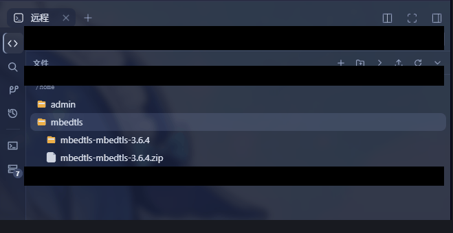
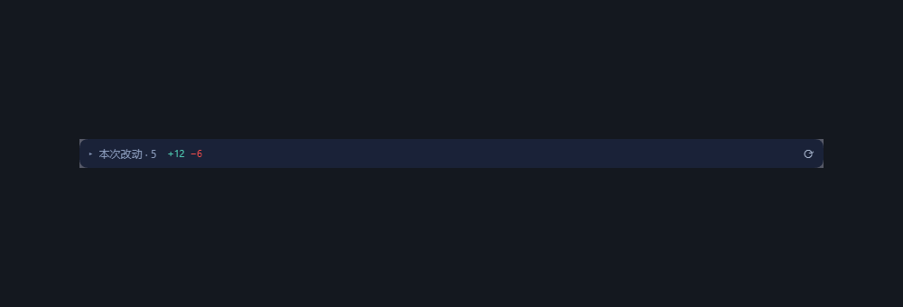

# dsh-remote-vs · VSCode-style remote development for DSH

[](./LICENSE)

[中文](./README.md) | English

SSH host management inside the DSH Host process + helper push pipeline + a **VS Code-style remote
workbench** (explorer / search / source control / commit graph with its commit-details pane / multi-tab editor / floating editor /
side-by-side diff / multiple terminals). Hosts live in DSH Settings ("Remote hosts"); with `dsh-better-sidebar` installed
there is an extra standalone "Remote" tab, otherwise it falls back to a native right-Sidebar "Remote"
page (same content, self-opened from the guide, per-session instances). The editor is ALSO mounted into
the conversation view slot as a "远程编辑器" (remote editor) tab next to "对话 / 轨迹", so the code area is
full width; the sidebar copy is the narrow fallback. Since P2, native tools inside remote workspaces
transparently run remotely (see below).

```text
┌─ Local DSH Host ─────────────────────────┐
│  Plugin host half   │  Client half       │
│  hosts/keys/push/   │  settings + native │
│  routing            │  entry takeover    │
│  /api/dsh-remote/*  │  explorer page     │
└─────────────────────┴────────────────────┘
       │ ssh2 (files/proc/terminal) + helper RPC (remote fs)
       ▼
┌─ Remote Linux ─────────────────────────────┐
│  ~/.dsh-helpers/<ver>/<arch>/dsh-ssh-helper│
│  user-chosen remote working directory      │
└────────────────────────────────────────────┘
```

## Install

```sh
dsh plugin --profile web add dsh-remote-vs
```

(From npm, recommended; installing straight from the repository also works:
`dsh plugin --profile web add github:xiray-xia/dsh-remote-vs`.)

Requires DSH `0.2.2-alpha.2` or newer (`engines.dsh` enforces the range; **the tested
baseline is `0.2.2-alpha.2`**). Older Hosts (`0.2.1-rc.2` generation) need plugin `0.9.3`: the
Remote preset of this version uses the `0.2.2-alpha.2` tool schema. `--profile web` selects which profile to install into —
this is a Web plugin, so it has to go into the profile your Web GUI runs from (`web` is
the common name; use your own profile's name). Desktop uses the reserved `desktop`
profile instead — see [Desktop](#desktop-dsh-desktop) below.

**That one command is all it takes — no build scripts have to be approved.** The package
has no `prepare`/`postinstall` and no package in the dependency tree carries an install
script (`ssh2` is **bundled into the artifact**, not depended on); the repository route
also ships the built `lib/`. The old "allow the printed build scripts in that profile's
`pnpm-workspace.yaml` and re-run" step was pnpm 12's hard policy gate for dependencies
with lifecycle scripts (`ERR_PNPM_GIT_DEP_PREPARE_NOT_ALLOWED` / `ERR_PNPM_IGNORED_BUILDS`);
it cannot be waived from the dependency side, only removed from the tree. Then restart
`dsh web` and open Settings → Remote hosts to configure.

### Desktop (DSH Desktop)

The Desktop app is an Electron shell around the complete dsh Web application, but it runs
in its own reserved profile, `desktop`, managed by the app itself: it does **not** share
`node_modules`, lockfiles, or plugin activation with the `web` profile of `dsh web`, so the
plugin has to be installed once for Desktop too. Sessions, settings, credentials and the
`dsh-remote.json` host configuration under `$DSH_HOME` are shared, so the host list needs
no re-setup.

Install either way:

1. **Desktop's Plugins page**: launch Desktop once → enter `dsh-remote-vs` (a pinned
   version works too) on the Plugins page → install → **fully quit** Desktop (tray Quit /
   application menu exit; the window close button only hides it) and reopen it.
2. **Desktop's bundled dsh command**: application menu → **Manage dsh Command… →
   Install**, fully quit Desktop, run `dsh plugin --profile desktop add dsh-remote-vs`,
   then reopen Desktop.

`desktop` is reserved for the Electron application: an **npm-installed `dsh` cannot manage
it** (it answers `profile "desktop" is managed exclusively by the Electron application`),
so one of the two routes above is required. The Desktop release version equals the DSH
runtime it bundles, and it must satisfy `engines.dsh` (`>=0.2.2-alpha.2`; check About);
older releases make the Plugins page refuse the install. Desktop opens no visible Web
port, but the plugin's HTTP routes and terminal socket are forwarded through Desktop's
Host (the terminal resolves its address from `__DSH_TRANSPORT__.streamBaseUrl`), so no
extra configuration is needed.

> The package carries the prebuilt helper (`vendor/dsh-remote-helpers/`, ~45 MB), so the
> first install is a large download — it is the **only** channel that delivers a helper
> (the official releases ship no helper executable), and dropping it would leave new hosts
> undeployable.

## Capabilities

### Remote workbench (VS Code-style UI)

| Capability | Notes |
| --- | --- |
| Explorer | Lazy tree + expand/collapse + hidden-files toggle; context menu: new / rename / delete / copy / move / paste / find in folder / insert `@` reference / **download to local** (files stream to this machine; a directory is archived on the remote host as a `.tar.gz` and streamed, so nothing is buffered in Host memory; a native **Save as** dialog picks the destination when the browser supports it, otherwise the browser's download folder; a bottom-left **download panel** shows live progress, allows cancel, and reports completion/failure; the search-hit menu offers it too); git status colours and folder roll-up marks |
| Search | Two modes: **file names** (remote `find`) and **contents** (remote `grep`). Content mode has a scope folder, `Aa` (case) / `ab_` (whole word) / `.*` (regex), results grouped per file with match highlights, and clicking a hit jumps to that line |
| Source control | **Repository-folder picker** (for workspaces whose git repository lives in a sub-folder: browse the remote tree, one-click jump to any repository discovered inside the workspace, type a relative or absolute path, and see which repository each folder resolves to); changes / staged / untracked / ignored buckets; **untracked directory rows expand on click**; per-file AND **per-hunk** stage / unstage / discard (behind a confirm) / commit; branches, remotes and stash panes; sync (fetch/pull/push), with **push refspec support** (Gerrit style `HEAD:refs/for/<branch>`; empty = plain `git push`, a non-empty value is remembered); fetch/pull/push/sync get a **live output panel** (server-sent events showing git/remote output, a running clock, **cancel** that kills the remote process group, and the full log for copying afterwards; an older Host without the streaming route falls back to the one-shot result) |
| Session change review | The **collapsible** panel above the composer: what THIS SESSION changed (one row per file, file-type icon, `+a −b` on the right); clicking a file opens it in the remote editor with **line shading plus character-level inline diff**, `n/N ↑↓` jumps between change points, and hovering a changed line offers **Undo this change** (remote `git apply -R`). See "Session change review" below |
| Side-by-side diff | Panes stay **exactly equal** + per-hunk buttons in the middle gutter + a **top horizontal scrollbar** (a very long line can no longer break the symmetry) + pinned line numbers, **rendering only the rows inside the viewport** (a 3000-line file goes from 9000 row containers to ~174, with exactly the same scroll range as a full render); switch between "before / after", and the after side is editable and savable |
| Commit graph | SVG branch/merge graph; selecting a commit opens the **resizable / expandable commit-details pane** below it with three views: **Commit details** (subject, author, time, full hash + copy, parents, refs, message body, checkout), **Contents** (changed files grouped by directory, collapsible and path-filterable; click for the diff, right-click or the row button to open in the editor), **Diff** (only the first ~1500 rows start expanded, later files start folded; both line numbers, `+/−` counts, line wrapping, previous/next-file navigation, and copy of one file's patch or the whole patch). Merge commits are shown against their **first parent** (git lists no files for a merge otherwise) |
| Multi-tab editor | Open/save/reload, dirty marks, several files at once; image preview, Markdown/HTML preview (source vs preview) |
| Floating editor | Three entries: "Open in floating editor" in the file-tree / search-hit / source-control context menus, plus **double-clicking the "remote editor" tab** to float the editor as it stands (same tabs, previews, diff, find and change marks — not a second, thinner editor). Drag the title bar to move, drag any of the eight edges/corners to resize, maximize/restore (or double-click the title bar); **minimize to a draggable floating ball** (dirty dot on it, click or press Enter to restore, drag to park it anywhere); `Ctrl+wheel` zooms the editor text. Position, size, font size and the ball's spot survive a page refresh |
| Syntax highlighting | VS Code **Dark+ / Light+** palettes; covers java/aidl/smali, c/c++, go, rust, js/ts, json, py, yaml, xml, html/css, md, sh, properties/rc/toml, diff …; a **fallback colorer** takes over when no grammar matches, so a file is never left monochrome. Honest caveat: kotlin / gradle / smali are coloured by the Java grammar (no dedicated package), which gets keywords, strings and comments right but does not split their own syntax |
| Find | In-editor `Ctrl+F` (`Aa` / `ab_` / `.*`, `3/17` count, ↑↓, `F3`/`Shift+F3`, `Esc`); **selected text is carried into the box by `Ctrl+F`**; the widget is pinned to the top-right and does not scroll away |
| Jump | Clicking a search hit opens the file at that line, centres it and **lights the landing line** (fades after ~2.6s); repeat jumps in the same file work |
| Terminals | Tabbed multi-terminal (`+` to create, `✕`/middle-click to close behind a confirm), across hosts; session ids are persisted so a page refresh reattaches to the running shells, and a session is kept for **10 minutes after its last socket goes away** (enough for a refresh or a browser-tab switch) before the remote shell is closed |
| Workspaces | Binding list + routing-mode dropdown + the dual-mode (local / remote) new-workspace wizard |

### Hosts and transport

| Capability | Notes |
| --- | --- |
| Host management | CRUD + connectivity test; key / password auth; config in `$DSH_HOME/dsh-remote.json` (0600), independent from `dsh-ssh.json` |
| Key bootstrap | One click generates a dedicated keypair on password hosts and deploys `authorized_keys`, key auth from then on |
| Push pipeline | Remote arch/OS probe → version compare → skip-if-same / else push; the executable channel pushes a self-built helper. A failed deploy no longer retries on every remote file operation: it backs off from **5 seconds up to 5 minutes**, and the Settings "Push" button forces an immediate retry |
| Remote files | SFTP browse / read / write / create / delete / rename. Boundaries hardened: 0-byte files no longer deadlock, and every SFTP operation times out at 60s and releases its channel; **a single directory listing is capped at 20000 entries** (the first 20000 after sorting — directories first, then names — announced in the host log; the protocol carries no "truncated" field, so the UI has no marker) |
| Remote terminal | ssh2 PTY + WebSocket, xterm rendering (copy-paste/theme-follow/reconnect-on-refresh); **a reattach only takes over, it does not resize** (a page reload no longer shrinks a running shell to 80×24); an output backlog applies real backpressure to the far end; **frames are capped at 1 MiB**, and pastes past 64 Ki characters are chunked on code points by the client instead of dropping the connection |
| Concurrent channels | At most **6** remote channels per host at a time (no longer colliding with the far end's sshd `MaxSessions`); the 7th queues for up to **30 seconds** and then fails with `remote host <alias> is busy` instead of piling on connections |
| Timeouts and process cleanup | Ordinary git commands default to 300 s (configurable); the **network verbs (fetch/pull/push/sync) default to 20 minutes with a 30-minute ceiling**. exec runs in its own session (`setsid --wait`); on timeout OR cancel it sends TERM and **escalates to KILL after 3 seconds**, reaping the child processes with it; a host without `setsid --wait` is detected by a one-shot probe and falls back to the old behaviour, with a host-log line saying the timed-out remote command may still be running |
| Git graph | Remote repo status + branches + SVG commit graph + commit details/contents/diff pane (exec + frontend parsing, zero Host additions) |
| Import | One-click import from `~/.ssh/config` and from an existing `dsh-ssh.json` (read once, no coupling) |

### Agent capabilities

| Capability | Notes |
| --- | --- |
| Agent tools | `remote_hosts` / `remote_exec` / `remote_read` / `remote_write` / `remote_ls` |
| **P2 transparent remote execution** | Native `read/write/edit/bash/glob/grep/jobs` inside remote workspaces run directly on the far end |
| **P3 remote @ references** | `@` in remote sessions completes remote files (fileReferences router: scoped live listings / bare queries via a remote rg index) |

## Project structure

```text
dsh_remote_vs/
├── cordis.patch.yml        # composition: plugin row + private local realm + routers + preset-remote
├── src/
│   ├── index.ts            # plugin entry: store/pool/worlds/routes/tools/preset-switch wiring
│   ├── protocol.ts         # frontend/backend wire contract (route table + pure types, shared)
│   ├── paths.ts            # four-piece addressing under $DSH_HOME (store/keys/build cache/alias dirs)
│   ├── store.ts            # host + binding + tombstone persistence (0600 JSON, atomic writes)
│   ├── pool.ts             # ssh2 long-lived pool (exec/shell/sftp/putFile, TOFU host keys)
│   ├── sftp.ts             # remote file engine (SFTP windowed reads-writes/tree ops)
│   ├── keygen.ts           # password-host key bootstrap (generate→deploy→flip)
│   ├── deploy.ts           # push pipeline (probe/compare/ship/double-verify/manifest)
│   ├── importers.ts        # ssh_config / dsh-ssh.json parsing importers
│   ├── routes.ts           # /api/dsh-remote/* route table + terminal WebSocket upgrade
│   ├── terminal.ts         # PTY session registry (reconnect-on-refresh/disconnect cleanup)
│   ├── tools.ts            # the 5 Agent tool definitions
│   ├── http.ts / loopback.ts # JSON body IO + loopback trust fence
│   ├── git-format.ts       # git command builders + pure frontend parsing (zero Host additions)
│   ├── git-ops.ts          # the full remote git surface: status/diff/branch/remote/stash/commit/hunk patch builders + parsers
│   ├── fs-ops.ts           # remote file-operation command builders (copy/move/remove/stat)
│   ├── search-ops.ts       # remote content search (grep builder + NUL-separated parser + match splitting)
│   ├── p2/                 # ── P2 transparent routing ──
│   │   ├── worlds.ts       # world decisions (cwd key/alias/tombstones) + remote RPC/FS/proc contexts
│   │   ├── helper-rpc.ts   # helper wire protocol over an ssh2 exec channel (handshake/heartbeat)
│   │   ├── router-fs.ts    # transparent fs router (target→world map/path translation/policy rewrite)
│   │   ├── router-subprocess.ts # transparent process router (argv0 reduction/pwsh gate)
│   │   ├── ssh-proc.ts     # ssh2 process runtime (setsid group kill/marker/stdin/spill)
│   │   ├── shell-bash.ts   # routed bash executor (local verbatim/remote strips DSH_*)
│   │   ├── router-spill.ts # transparent spill router (session world key/remote dir)
│   │   ├── router-refs.ts  # transparent @ reference router (agent world key, P3)
│   │   ├── file-refs.ts    # remote @ search (live fs-ssh listings/rg index/ported stock scoring)
│   │   ├── bridge.ts       # private-realm local publishes (localFs and other early services)
│   │   └── bridge-refs.ts  # standalone refs bridge (local-refs needs workingDirectory: must split)
│   └── client/             # ── browser half (React, bundled into lib/client.js) ──
│       ├── index.tsx       # surface decision (better-first/settle-boost/native fallback) + settings + directoryFlow takeover
│       ├── store.tsx       # module-level state shared by both surfaces (useSyncExternalStore; open files/terminals/view live here)
│       ├── RemoteRoot.tsx  # sidebar surface: VS Code activity rail (explorer/search/SCM/history/editor/terminal/workspaces)
│       ├── RemoteEditorView.tsx # conversation-view surface (the "remote editor" tab next to 对话/轨迹, full width)
│       ├── RemoteExplorer.tsx   # explorer: tree + context menu + file ops + @ references + status marks
│       ├── SearchView.tsx       # search panel: name / content modes + Aa/ab_/.* + grouped hits + jump
│       ├── EditorPane.tsx       # editor pane: tabs + info bar (build stamp / tok count) + image/MD/HTML preview
│       ├── FloatingEditorWindow.tsx # floating window frame (title-bar drag/8-way resize/maximize/ball minimize/font zoom)
│       ├── float-tab-trigger.ts     # double-click on the "remote editor" tab (the tab row is the host's, so label-based)
│       ├── FloatingPlaceholder.tsx  # "docked elsewhere" placeholder + dock button left on the other surfaces
│       ├── float-editor.ts      # window geometry/resize/surface rules (pure; driven directly by the self-check)
│       ├── live-editor.ts       # live buffer + scroll/caret handoff across a surface change
│       ├── CodeEditor.tsx       # CodeMirror wrapper: grammar table/theme/find widget/jump/fallback wiring
│       ├── scm/            # ── source control ──
│       │   ├── ScmPanel.tsx     # changes/staged/untracked + per-file and per-hunk actions + commit box
│       │   ├── DiffView.tsx     # side-by-side diff (top scrollbar/hunk buttons/editable after side)
│       │   ├── HistoryPanel.tsx # SVG commit graph + resizable/expandable commit-details pane
│       │   ├── CommitPane.tsx   # details/contents/diff tabs + patch toolbar + context menus
│       │   ├── commit-model.ts # patch blocks/line numbers/counts/directory grouping/file stepping (pure)
│       │   ├── actions.ts       # remote git action layer (over the exec channel)
│       │   ├── diff-model.ts    # unified diff → side-by-side row projection (pure)
│       │   └── status-map.ts    # status bucketing + tree marks (pure)
│       ├── vsc/            # ── VS Code skin and controls (zero new runtime deps) ──
│       │   ├── kit.tsx / vsc.css    # icons/dialogs/context menu/segmented control + all styles (scoped to .rvs-root)
│       │   ├── editor-palette.ts    # Dark+/Light+ palette + fixed class names (rvs-ck-*)
│       │   ├── editor-theme.ts      # editor chrome theme (live light/dark swap)
│       │   ├── editor-langs.ts      # file extension → CodeMirror grammar
│       │   ├── fallback-highlight.ts# coloring used when no grammar matched (via tokenize.ts)
│       │   ├── FindWidget.tsx       # Ctrl+F find widget (pinned top-right)
│       │   ├── reveal-line.ts       # jump + landing-line highlight
│       │   ├── tokenize.ts / markdown.tsx # read-only pane tokenizer / dependency-free markdown renderer
│       ├── NativeExplorer.tsx# native page type definition + seat body (no-sidebar fallback)
│       ├── composer.ts / use-remote-chat-target.ts / selection-popup.ts # remote @refs/selection-to-chat
│       ├── api.ts          # typed fetch wrapper over /api/dsh-remote
│       ├── HostsView / WorkspacesView / WorkspaceWizard / TerminalView / XTerm / Dialog
│       ├── SettingsHosts.tsx        # settings occupants (host mgmt/binding list, self-fetching)
│       ├── DirectoryFlow.tsx        # native entry occupant (local dual-mode/remote wizard)
│       ├── RemoteDirectoryPicker.tsx# remote directory browser dialog
│       └── i18n.ts / theme.ts / ui.tsx # bilingual dictionary/theme signal/shared styles
├── vendor/dsh-remote-helpers/ # helper seeds (shipped, seeded into cache at startup, see below)
├── docs/                   # local-only working docs (never pushed to GitHub)
│   ├── P2-PLAN.md          # P2 architecture/phases/acceptance matrix (with per-item status)
│   └── MAINTENANCE.md      # local-only (.gitignore), not shipped: DSH upgrade impact + helper procedure
├── locale/                 # bilingual plugin metadata
└── lib/                    # build output (gitignored, restart after link install to take effect)
```

`vendor/dsh-remote-helpers/` (committed) holds helper seeds: at startup the plugin spreads them into
`$DSH_HOME/dsh-remote-helpers/` (copy-if-absent, never overwrites), so fresh installs can push right away.
When a new helper is built, swap the 4-piece set (tarball + sha256 + helper.json + patch notes)
into vendor and commit (details live in the local-only `docs/MAINTENANCE.md` §4, which is gitignored and not distributed).

`.spike/` and `scripts/` (both gitignored, **never distributed with the repository**) hold the
development-time verification and self-check scripts: `.spike/` has the live-host ones — `p2-router.ts`
main regression (real remote + real Cordis + real router classes) and probes like `grep-probe.mjs`
(build with the local `tsconfig.scratch.json`), plus `model-check.mjs` / `reveal-check.mjs` /
`fallback-check.mjs` / `client-load-check.mjs` / `tool-schema-check.mjs` which need no host at all;
`scripts/` has the plain-node regression gates (`node scripts/check-*.mjs`, with `verify-lib.mjs`
checking the build artifact). Both are covered under "Development".

## Remote workbench (VS Code style)



Both surfaces share one state module (`store.tsx`): **the sidebar "Remote" page** (a standalone tab when
`dsh-better-sidebar` is installed, otherwise the native right-Sidebar page) and **the conversation-view
"remote editor" tab** (next to 对话/轨迹, giving the code area full width).

- **Activity rail**: explorer / search / source control / commit graph / editor / terminal / workspaces.
  A panel stays mounted after its first visit, so switching back neither refetches nor flashes. While it is
  hidden it does **no remote work** (directory listings, the SCM stash/branch/remote queries and editor
  image reads all wait for the next foreground pass), and visibility is MEASURED on the plugin root
  (IntersectionObserver) instead of being taken from a host prop.
- **No blank wait when switching workspaces**: the last git state read for each (workspace, repository
  directory) is kept in memory, so switching back paints the change list, branch and tree marks **in the
  same frame** and re-reads behind it. The panel says "cached · refreshing" meanwhile; the change list and
  the stage/commit/discard buttons still act on that workspace (⟳ and "reset repository directory" are
  disabled while the background read runs — pressing them would only queue a second walk of the same tree).
  One git read per repository DIRECTORY at a time (changing the directory lets the two directories' reads run
  side by side — they are two different walks); a manual refresh's answer is always post-click (it queues
  after the running read); a read of a workspace you left behind only fills its own cache and never repaints;
  a failed background read keeps the list and shows why instead of declaring the workspace "not a
  repository". The first visit to a workspace still waits — cache cannot invent a read.
- **Editor**: tabs plus an info bar (path, language, **build stamp**, `tok N` coloured-token count,
  saved state, reload/save). Those three marks exist for troubleshooting: the stamp answers "is the
  browser running the bundle I just built?", `tok 0` answers "did a grammar match this extension?".
- **Floating editor**: "Open in floating editor" from the file-tree / search-hit / source-control context
  menus, or double-click the "remote editor" tab, lifts the editor into a window above the shell (same tabs
  and buffers; closing or docking puts it back on its original surface). Drag the title bar, resize from the
  eight edges/corners, maximize/restore; **minimize to a 44px floating ball** (no full-width bar — park it in
  any corner, click/Enter restores it, and it shows a dot while there are unsaved edits); zoom the text with
  `Ctrl+wheel`; unsaved text is explicitly handed over between the main surface, the floating window and tab
  switches (the disk-side baseline is kept separately, so the dirty mark can never be mistaken for saved).
- **Find and jump**: `Ctrl+F` opens a widget pinned to the editor's top-right corner
  (`position: fixed` anchored to the editor's rect, so no ancestor scroller can carry it away);
  a selection is carried into it by `Ctrl+F`; a jump from the search results centres the line and
  lights it up.
- **Terminals**: tabbed sessions with the session id persisted one by one, so a page refresh reattaches
  to the shells that are still running; **a reattach only takes over, it does not resize** (a live shell is
  never shrunk to 80×24 — the true size comes from the one tab that can measure itself, sent as a `resize`
  frame); a session is kept for **10 minutes** after its last socket goes away before the remote shell is
  closed (it used to be kept forever, so closing the browser left the shell holding an sshd session slot).
- **Known limits (stated honestly)**:
  - There is **no public API to select the "remote editor" view**; the plugin can only click the shell's
    own tab by its label and toasts a hint when that fails (`revealEditor()`).
  - Untracked directories arrive as a **single `dir/` row**; clicking it **expands** the files inside
    (one path-limited `git status -uall -- dir/`, so the cost tracks the directory, not the repository;
    click again to collapse). An expansion is a snapshot of the moment it was opened — collapse and
    re-expand to refresh it.
  - Opening a file is capped at 8MiB (official helper constant); beyond that it is shown read-only.
  - The find widget floats above the code (like VS Code) and takes no layout space.
  - Output backpressure is **per shell**: one tab that cannot keep up pauses every tab attached to that
    shell — a deliberate trade, preferring to hold the remote command back on behalf of the slowest
    consumer over letting host memory grow without bound.
  - A directory listing past 20000 entries is truncated, and since the protocol has no "truncated" field
    the UI shows **no marker at all** — only the host log line
    `listing <path> on <alias> shows 20000 of N entries`.

## Session change review (Cursor style)



The **collapsible** panel above the composer (titled "本次改动") answers, per **session**, "what did this turn
change?". Its data comes from the plugin's own change ledger (`/api/dsh-remote/changes`), not from DSH's
`workspaceChanges` — the latter cannot see a routed session at all (the probe measured 58 remote sessions
with zero change events).

- **The panel**: one row per file (file-type icon + relative path + `+a −b` on the right), aligned left and
  right with the composer card; click the header to collapse/expand, `⟳` forces an immediate rescan. With no
  changes it says "this session has not changed any file yet"; when it cannot compute, it states the
  **specific reason** (see the limits below) instead of handing you an empty list to guess about.
- **Clicking a file** opens it in the remote editor with change marks: added lines get a **green line
  background**, deleted characters are drawn as an **inline struck-through chip** (a deleted character does
  not exist in the new file, so it can only be an inserted widget), and the left gutter carries a change bar.
- **Jumping between change points**: the floating `n/N ↑↓` control at the editor's top-right
  (`Alt+Shift+Cmd/Ctrl+↓/↑`) cycles through them; typing in the editor invalidates the marks and says
  "position may be out of date".
- **Undo this change**: hover a changed line and click → remote `git apply -R`. When the context no longer
  matches, the far end refuses outright (not one byte of the file changes); a tab with unsaved edits is
  refused first, so a remote patch can never overwrite your buffer; on success the caret stays where it was
  and the marks are re-read (they do not simply vanish because something was undone).
- **Follow the session's workspace**: the sidebar, the editor's dropdown and the file tree all follow the
  workspace the **current session** lives in; after a manual switch they are not pulled back within that
  session, and a new session follows again. The capability lives in the store, so it works even when **the
  sidebar was never opened**; clicking a changed file is "show me this result", not a manual switch.
- **Repository directory**: the one the user picked under Source control → repository directory always wins;
  when the session root is not a repository, a single candidate one level below is adopted automatically,
  while several candidates produce an explicit hint to set it in Source control.

**Known limits (stated honestly)**:

- The baseline is the **session start**, not HEAD: untracked files that already existed before the session
  began are not counted as this session's work.
- Tracked files refresh when a **turn ends** (the panel polls every 3 seconds as a backstop, so the numbers
  usually catch up within a second or two); **new files** created in a shell are found by a **slow scan**
  whose single-run budget is up to **3 minutes**, re-run at a self-tuning interval (at least 5 seconds,
  naturally longer on a huge checkout). `⟳` forces an immediate rescan.
- A non-git workspace, or one holding several repositories with no repository directory set, shows the exact
  reason (`no git repository at the workspace root, and N candidates below it — set the repository directory
  in Source Control`) rather than an empty list.
- Binary and oversized files are marked "binary / too large" on the row and get no character-level diff.

## P2 transparent remote execution (Windows native)

Single-Host mixed routing: native tools dispatch by which world the session cwd lands in — remote aliases go
over helper RPC (fs) / ssh2 (processes), local stays untouched; both share one Host and one GUI.

- Alias dirs: `$DSH_HOME/remote-ssh/aliases/<id>` (empty shells, routing keys only), auto-registered into the native workspace list as `<server> > <base>`
- Routing switch (dropdown at the top of Settings → Remote hosts; underneath it is profile patch `- id: remote-vs`, `config.routingMode`, volatile, no restart):
  default `enforce` (real routing); switch to `off` (pure local passthrough) / `shadow` (logs, still local) as debugging escapes
- New workspace: the native "Add workspace…" entry is adopted (local/remote dual tab; remote leg = host→push→bind wizard)
- Presets: a `Remote` preset (bash toolset); under enforce, new remote sessions switch to it automatically (default preset only, never overrides an explicit choice)
- Ground truths (measured, not assumed):
  - Remote `grep/glob` call remote `rg` through routing (both measured hosts ship rg 13; no remote rg means no hits)
  - Whole reads >8MiB report `FS_TOO_LARGE` (official helper ceiling) — use streaming/paged reads; **writes are uncapped** (a 46MiB whole write passed live)
  - Oversized process output lands in a Host temp spill file (`readFrom` returns tail + path, full text lives in the file — same as stock)
  - After unbinding, new calls are explicitly refused (fail-closed tombstones), history stays readable
  - Disconnects: in-flight calls are not replayed; new calls reconnect automatically
- Verify: `npx tsc -p tsconfig.scratch.json && node .spike/build/.spike/p2-router.js`
  (real remote + real Cordis + real router classes, 61/61; P0 routing and GUI need a Host restart + smoke pass)
- Details: `docs/P2-PLAN.md` (§8 acceptance matrix with per-item status)

## Self-built helper (P1)

Upstream never published helper binaries (all Release assets are empty), so this plugin builds its own:

- Build machine: WSL2 Ubuntu-22.04 (glibc 2.35, matching the remote targets), Node v24.21.0 + pnpm 11.28.5
- Sources: the `dsh-v0.2.1-alpha.2` tag (the **build baseline**: what must match is the wire protocol version, not the Host version — our protocol is still **2**, so a Host upgrade to `0.2.2-alpha.2` needs no rebuild either: the plugin intentionally stays on `dsh-ssh@0.2.1-rc.2`, and the new generation's protocol 3 is deliberately not followed — see §2.26 of the maintenance notes)
- Command: stock script `pnpm exec tsx scripts/build-exe-for-ssh-helper.ts --target=node24-linux-x64`
- Only deviation: no docker for the manylinux 2.28 rebuild, so a `DSH_GLIBC_CEILING`
  env override was added (default stays 2.28); this build targets 2.35 (see `glibc-ceiling.patch` in the cache dir)
- Checks: stock `verify-ssh-helper-artifact.ts --sandbox=required`, all 8 green
- Cache: `$DSH_HOME/dsh-remote-helpers/` (`*.tar.gz` + `.sha256` + `.helper.json`
  with binarySha256, feeding P2's helperHash)
- Full rebuild procedure for upgrades: the local-only `docs/MAINTENANCE.md` §4 (gitignored, not distributed)

## Security model

- All `/api/dsh-remote/*` routes are loopback + same-origin only.
- Passwords / key passphrases are stored in plaintext in `dsh-remote.json` (0600) — same trust model as the existing SSH plugin.
- Pushed artifacts are sha256-verified both ways (tarball in, binary out); the helper install dir is separate from workspaces.
- Remote sessions may read explicit local absolute paths (the tool spill-file contract requires it); acceptable under the same model trust — see `docs/P2-PLAN.md` §4 note.

## Development

```sh
pnpm install
pnpm run typecheck
pnpm run build
dsh plugin --profile web add link:<absolute path of this directory>
```

**How a change goes live: `pnpm run build`, then restart `dsh web` — for the host half and the client half alike.**
**`lib/` is committed.** The package has no `prepare` script (pnpm 12 refuses to run one for a git
dependency), so a `dsh plugin add github:…` user receives the repository as it is: **after editing
source you must `npm run build` and commit `lib/` with it** (`node scripts/verify-lib.mjs` checks that the
entries are present, committed and loadable; the self-check scripts live on the maintainer's machine only,
see below).
The Host reads plugin bundles into memory at startup (`initialBundleSnapshot`: it stats mtime/ctime/size into a
revision, then reads the bytes; the response carries `Cache-Control: public, max-age=31536000, immutable`), so a
**client-only** change (`src/client/**`) behaves exactly the same way: a browser refresh — `Ctrl+Shift+R`
included — only re-fetches the bytes captured at startup, under the same `rev`. How to tell:

1. Each build injects a stamp (`MMDD-HHmm`) into `lib/client.js`, shown at the right of the editor info bar;
2. Restart `dsh web` → refresh the page: **the stamp must change** (if it does not, you are still on the bytes
   captured at startup);
3. For colour issues, read `tok N`: `0` means no grammar matched the extension AND the fallback colorer
   did not take over (the console line next to it names the file).

> The one exception is DSH's own development watcher (`pnpm run dev:web`, via `ClientModuleRegistry.rebuilt`);
> there is no watcher on a plugin user's side and `dsh web --help` has no watch option, so "restart" is the rule.

Self-checks (no host, no DSH, a few seconds each):

```sh
node .spike/client-load-check.mjs # really evaluates the client modules: load-time errors tsc/bundler/other harnesses miss
node .spike/tool-schema-check.mjs # all 5 agent tools: run execute, then validate the result with the RUNTIME's own validator
node .spike/model-check.mjs      # 55 checks: real git output → parsers, diff model, hunk patches, class↔CSS contract
node .spike/reveal-check.mjs     # 5 checks: jump target, landing highlight, repeat jump in one editor
node .spike/fallback-check.mjs   # 12 checks: the fallback colorer colours java/cpp/shell in a real DOM
node .spike/editor-dom-check.mjs # 12 checks: a real CodeMirror in jsdom emits colour spans for java/shell/cpp
node .spike/i18n-check.mjs       # zh/en dictionary consistency: no missing key, no orphan, matching placeholders
node .spike/ref-check.mjs        # 32 cases: assertRef accepts real revision suffixes, rejects every injection surface
node .spike/status-check.mjs     # runs the generated git commands in a real shell to prove exit codes are no longer masked
node .spike/cache-check.mjs      # incremental token cache vs whole-document tokenizing, 9 languages × 8 edit shapes
node .spike/layout-check.mjs     # height chain + scrollbar contract: header rows stay pinned, the bar is wide enough to grab
node .spike/viewstate-check.mjs  # scroll+caret round trip across a remount (stateful scrollTop: tells "restored" from "reset")
node .spike/tabswitch-check.mjs  # real React drives three wirings: both ref-reading ones must fail, reporting must pass
node .spike/letter-check.mjs     # status letters: untracked `?` no longer collides with conflict `U`, plus both render sites
```

`.spike/layout-fixture.html` (generated by `build-fixture.mjs`) is the fixture for
measuring layout in a browser: it mechanically inlines the **host's real slot CSS**
and the **shipped vsc.css**, so after a CSS change you re-run
`node .spike/build-fixture.mjs` and can measure the height chain, the scroll
container and the scrollbar width for real. Pure-CSS defects are invisible to
tsc, to the bundler and to jsdom — this fixture is the only place they reproduce.

`markdown-check.ts` has to be compiled first (it imports a `.tsx`, which Node cannot load):
`npx tsc -p tsconfig.scratch.json && node .spike/build/.spike/markdown-check.js`.

> `.spike/` is git-ignored, so these checks are local only and run in no CI. **Run them before quoting any
> number** rather than copying a figure out of any file — one `model-check` count drifted across the README,
> the local maintenance doc and the review reports as 44 / 48 / 55, while the harness actually prints 55/55
> (its source holds 57 `check(` call sites, 2 of them inside loops and reachable only on failure, which is
> exactly why "57 call sites" and "55 checks run" differ by 2).

The live-host regression is still `npx tsc -p tsconfig.scratch.json && node .spike/build/.spike/p2-router.js`.
Before touching anything for a new DSH release, read the local-only `docs/MAINTENANCE.md` (§2 coupling points, §3 checklist) — it is gitignored, so a clone will not have it. The mandatory steps after a host-half change are `pnpm run verify:lib` plus the load self-check.

## License

MIT © 2026 xiray-xia — see [LICENSE](./LICENSE).

The `vendor/` helper seed is built from DeepSeek Harness sources (MIT) at tag `dsh-v0.2.1-alpha.2`
with the stock build script; see "Self-built helper" above for the exact procedure and the single
documented deviation (`glibc-ceiling.patch` in the seed set).
