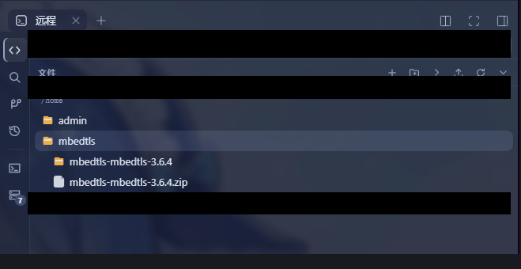
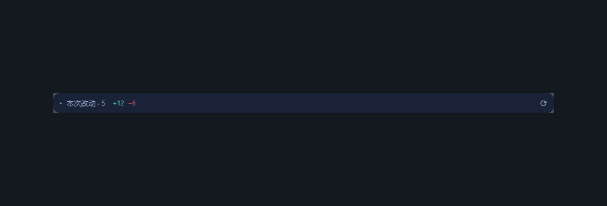

# dsh-remote-vs · DSH 远程开发（VSCode 式）

[](./LICENSE)

中文 | [English](./README.en.md)

Host 进程内的 SSH 主机管理 + helper 推送流水线 + **VS Code 式远端工作台**
（资源管理器 / 搜索 / 源代码管理 / 提交图与提交详情面板 / 多标签编辑器 / 悬浮编辑器 / 并排 Diff / 多终端 / 端口转发）。
主机配在 DSH 设置里（“远程主机”项）；装了 `dsh-better-sidebar` 时另有
独立“远程工作台”tab，没装则退到原生右侧栏“远程工作台”页（同内容，引导页自助开，per-session 实例）。
编辑器还额外挂到会话视图槽，与“对话 / 轨迹”并列成一个**远程编辑器**标签，
这样代码区是整屏宽的；右侧栏那份是窄屏备用面。
P2 起原生工具在远端工作区里透明跑远端（见下）。

```text
┌─ 本机 DSH Host ─────────────────────────────────┐
│  本插件 Host 半      │  Client 半（浏览器）     │
│  主机/密钥/推送/路由 │  设置两节 + 原生入口接管 │
│  /api/dsh-remote/*   │  工作台（右侧栏 + 会话视图）│
└──────────────────────┴──────────────────────────┘
       │ ssh2（文件/进程/终端）+ helper RPC（远端 fs）
       ▼
┌─ 远端 Linux ─────────────────────────────────┐
│  ~/.dsh-helpers/<ver>/<arch>/dsh-ssh-helper  │
│  用户指定的远端工作目录                        │
└──────────────────────────────────────────────┘
```

## 安装

```sh
dsh plugin --profile web add dsh-remote-vs
```

（从 npm 装，推荐；也可以直接跟仓库装：`dsh plugin --profile web add github:xiray-xia/dsh-remote-vs`。）

**需要 DSH `0.2.2-rc.2` 及以上、`0.3.0` 以下**（`engines.dsh` 门到底；已按 rc.2 适配并通过类型检查与本地全量门禁）。
Host 仍是 `0.2.2-alpha.3` / `0.2.2-rc.1` 的请用插件 `0.20.1`；`0.2.2-alpha.2` 一代请用 `0.17.0`；`0.2.1-rc.2` 一代请用 `0.9.3`。
`--profile web` 指明装进哪个 profile —— 本插件是 Web 插件，
要装进 Web GUI 所用的那个（`web` 是常见命名，以你自己的 profile 名为准）；
桌面端用的是保留 profile `desktop`，见下面「桌面端」。

**这一条命令就够了，不需要放行任何构建脚本**：包本身没有 `prepare`/`postinstall`，依赖树里也没有任何
带安装脚本的包（`ssh2` 是**打进产物**的，不是依赖）；走仓库安装时还带着构建好的 `lib/`。
以前需要「在 profile 的 `pnpm-workspace.yaml` 里放行构建脚本后重跑」，那是 pnpm 12 对
「带安装脚本的依赖」的硬策略门（`ERR_PNPM_GIT_DEP_PREPARE_NOT_ALLOWED` / `ERR_PNPM_IGNORED_BUILDS`），
依赖侧无法豁免，只能从树里消掉。装完重启 `dsh web`，打开设置 → 远程主机开配。

### 桌面端（DSH Desktop）

桌面端是 Electron 壳 + 完整的 dsh Web 应用，但它跑在**独立的保留 profile `desktop`**
里（由桌面端自身管理）：和 `dsh web` 的 `web` profile **不共享** `node_modules`、锁文件
和插件激活，需要在桌面端再装一次。`$DSH_HOME` 下的会话、设置、凭据和
`~/.dsh/dsh-remote.json` 主机配置是共享的，所以主机列表不用重配。

安装（二选一）：

1. **桌面端「插件」页面**：完全启动桌面端一次 → 插件页输入 `dsh-remote-vs`（可钉版本）
   安装 → **完全退出**桌面端（托盘 Quit / 菜单退出；点窗口 × 只是隐藏到托盘）再重开。
2. **桌面端自带的 dsh 命令**：应用菜单 → **Manage dsh Command… → Install**，然后
   完全退出桌面端，执行 `dsh plugin --profile desktop add dsh-remote-vs`，再重开。

注意：`desktop` 是桌面端独占的保留 profile，**npm 全局安装的 `dsh` 不能管理它**
（会报 `profile "desktop" is managed exclusively by the Electron application`），
只能走上面两条路径。桌面端的版本号等于它捆绑的 DSH 运行时版本，同样要满足
`engines.dsh` 要求（`>=0.2.2-rc.2`，关于面板可看）；低于该版本时插件页会直接拒绝
安装。桌面端没有可见的 Web 端口，但本插件的 HTTP 路由与终端 socket 都经桌面端的
Host 转发（终端按 `__DSH_TRANSPORT__.streamBaseUrl` 解析地址），无需额外设置。

> 包内含预编译的 helper（`vendor/dsh-remote-helpers/`，约 45 MB），所以首次安装下载量偏大 ——
> 它是**唯一**的 helper 投放渠道（官方 Release 不带 helper 可执行文件），去掉它就没法给新主机部署。

## 能力

### 远端工作台（VS Code 式 UI）

| 能力 | 说明 |
| --- | --- |
| 资源管理器 | 懒加载目录树 + 单击目录即展开/折叠 + 隐藏文件开关；**新增悬停 150 ms 预取**下一层列表（展开时先用缓存上屏、后台再校验；预取仍未返回时点开会等它，与冷启动一样显示加载行）；Host 侧浏览请求复用**一条常驻 SFTP 会话**，一次列目录的往返从 2 个降到 1 个（**冷启动或空闲 2 分钟关闭后的第一次仍要开会话**）；右键菜单：新建/改名/删除/复制/移动/粘贴/在此文件夹查找/插入 `@` 引用/**下载到本地**（文件流式下载、目录或**多选**在远端打包成 `.tar.gz` 流式下载，不占 Host 内存；浏览器支持时先弹**另存为**对话框选保存路径，不支持时落到默认下载目录；右下角**下载面板**显示实时进度、可取消，并提示完成/失败；搜索结果右键同样支持；下载结果分「已保存 / 已交给浏览器 / 失败」三态，交给浏览器后**不再显示成已完成**，Host 失败也不会被当成文件存下；树空白区也有右键菜单（新建/上传/粘贴），上传、粘贴、拖放等写操作**串行**（另一个传输进行中会拒绝并提示）；键盘可用（`↑↓` 选择、`←→` 折叠/展开、`Enter` 打开、`Shift+F10` 菜单），对话框有焦点陷阱与 `Esc` 关闭）；git 状态色与文件夹聚合标记；**文件/目录按类型着色**（彩色纸张 + 类别标记、琥珀色目录开合，与本地侧栏同款；仅目录树，其它列表保持单色）；**拖拽悬停展开**：拖动行或拖入系统文件时，指针在收起目录上停留约 650 ms 就自动展开该目录（spring-loaded folder，松手即落在已展开的目标里；中途取消不会留下自动展开） |
| 传输性能 | 上传/下载走 SSH 的 **256 KiB × 32 并发窗口**（ssh2 pipelined SFTP）：单文件下载与拖放上传比单流快约 8 倍，helper 推送（45 MB 包）同样走并行 `fastPut`；大文件上传不再被 60 秒期限误杀（改用进度看门狗）。**大于 4 MiB 的下载再开一条专用 SFTP 通道**（单条 SSH 通道的窗口上限是 2 MiB，多一条通道多一个窗口）：同进程交错 A/B 实测**约 1.1–1.4×**（多次采样中位 1.08–1.43×，随链路波动；原始读探针 1.6–1.8×，产品只开两条通道，不开四条）；小文件不开第二条，省一个通道槽。上传保持单通道（服务端写入是瓶颈，多通道无收益） |
| 搜索 | 两档：**文件名**（远端 `find`）与**内容**（远端 `grep`）。内容档带范围目录、`Aa`（大小写）/`ab_`（全字）/`.*`（正则）、结果按文件分组、命中高亮，点条目跳到该行；**内容档可中止**（改写或清空查询会终止正在跑的远端 `grep`；老 Host 无流式路由时退化为不可取消的一次性查询），成功但远端给了 stderr 警告时在结果上方提示；文件名档里命中**目录**时在树中定位，而不是当文件打开 |
| 连接状态与离线只读 | 顶部栏与编辑器信息栏显示当前工作区的 SSH 连接状态（**连接正常 / 连接异常 / 就绪·按需连接**）：断线不再静默——已打开的编辑器标签保留缓存内容并切为**只读**（保存被拦截并说明原因），目录树继续显示已缓存目录、后台刷新静默，未缓存目录显示离线提示；连接恢复后自动刷新目录、Git 状态、**未修改的文件标签和只读 diff 标签**（有未保存改动的标签不动并提示）。错误态不会无限重连：每 30 秒最多自动重试 3 次，之后点状态图标手动重试。断线时「撤销这处改动」和 diff 的 hunk 操作同样被拦截；**单次操作的超时（deadline）不当作链路故障**——chip 保持正常，只有该次操作失败并说明原因；断线且该工作区没有缓存时，SCM 面板直接说明无法读取，而不是停在「加载中」。**不做**跨页面刷新的持久化缓存（远端源码不落盘），这是有意的隐私取舍 |
| 源代码管理 | **仓库目录选择器**（工作区里的 git 在子目录时用：浏览远端目录、一键跳到工作区内发现的仓库、手输相对/绝对路径，并逐目录提示会落在哪个仓库）；变更/暂存/未跟踪/忽略分桶，**未跟踪目录行可点击展开**，逐文件与**逐 hunk** 暂存/还原、丢弃（带确认）、提交；分支/远程/stash 面板；同步（fetch/pull/push），**推送支持自定义 refspec**（如 Gerrit `HEAD:refs/for/<分支>`；留空 = 普通 `git push`，非空值会记住）；fetch/pull/push/sync 有**实时输出面板**（SSE 流式显示 git/远端输出、运行计时、**可取消**（杀掉远端进程组）、完成后可复制完整输出；老 Host 无流式路由时自动回退到一次性结果） |
| 会话改动审阅 | 输入框上方的**可收纳**面板，按**会话**列出改了什么（一行一个文件、文件类型图标、右侧 `+a −b`）；点文件在远程编辑器里打开并画**整行着色 + 行内字符级差异**，右上角 `n/N ↑↓` 跳改动点，悬浮改动行可**撤销**这处改动（远端 `git apply -R`）。详见下文「会话改动审阅」 |
| 并排 Diff | 左右**严格等分** + 中间 gutter 逐 hunk 按钮 + **顶部横向滚动条**（一行很长也不会破坏对称）+ 行号钉在左侧，**只渲染视口内的行**（3000 行文件从 9000 个行容器降到约 174 个，滚动范围与整篇渲染完全一致）；可切「变更前 / 变更后」，变更后可编辑并保存（保存写回工作树文件；超过 8MiB 的差异只读，避免把截断内容写回去） |
| 提交图 | SVG 分支/合并图；点选提交后，下方**可调高度 / 可全屏**的提交详情面板给出三个视图：**提交详情**（标题、作者、时间、完整哈希+复制、父提交、ref、正文、检出）、**内容**（改动文件按目录分组、可折叠、可过滤，单击看差异、右键或行尾按钮在编辑器中打开）、**差异**（默认只展开前约 1500 行、其余文件折叠；双行号、`+/−` 计数、自动换行、上一/下一个文件、复制文件补丁或整个补丁）。合并提交按**首父**展示（git 对 merge 默认不给文件列表） |
| AI 审查 | 单文件 diff 与**整个提交**都能一键把审查请求追加到对话草稿（**只预填，不自动发送**，发送前可自行修改）：≤32 KiB 内嵌完整 diff；更大或被 2 MB 静默截断时改为「文件/提交信息 + 变更块头 + 自行 `git show`」的摘要式请求（2 MB diff 约几十万 token，硬塞没有意义）；未跟踪/二进制文件只给路径让 AI 自行读取。入口：并排 diff 工具栏、提交详情「差异」工具栏；当前会话不在该远端工作区、或宿主没有可用的对话输入通道时按钮禁用并写明原因 |
| 多标签编辑器 | 打开/保存/重载、脏标记、多文件标签并存；**保存是原子的**（侧文件 + 重命名，写穿符号链接并保留权限位）；**保存前校验远端基线**：文件在打开之后被别人（Agent 的透明路由、终端、另一个编辑器）改过时保存被拒绝，并给出「覆盖 / 载入远端版本 / 查看差异」，不再静默覆盖；图片预览、Markdown/HTML 预览（源码/预览切换）；关闭标签、重载、切工作区遇到未保存改动都会**先确认**（切工作区会清空全部标签，所以先问）；`Ctrl+S` 全局生效，焦点不在编辑器里也能保存；**刷新页面后自动恢复上次打开的文件标签**（按工作区记，最多 12 个；只存路径不存内容，打不开的会跳过并提示数量；光标与滚动位置不恢复） |
| 悬浮编辑器 | 三个入口：文件树 / 搜索结果 / 源代码管理右键「在悬浮编辑器中打开」，以及**双击会话视图的「远程编辑器」标签**把当前编辑器整体浮出（同一套标签、预览、Diff、查找、改动标记，不是另写一个编辑器）。窗口可拖标题栏移动、拖八个边角缩放、最大化/还原、双击标题栏切换最大化；**最小化成一个可拖动的悬浮球**（球上有未保存脏点，点一下或按 Enter 恢复，拖动可换位置）；`Ctrl+滚轮` 缩放编辑器字号；位置、大小、字号和球的位置跨刷新记住 |
| 语法高亮 | VS Code **Dark+ / Light+** 配色；覆盖 java/aidl/smali、c/c++、go、rust、js/ts、json、py、yaml、xml、html/css、md、sh、properties/rc/toml、diff 等；**兜底着色器**在语法包没命中时自动接管，不会出现整篇无色。诚实说明：kotlin / gradle / smali 用 Java 语法着色（没有专用语法包），效果是关键字/字符串/注释正确、专有语法不细分 |
| 查找 | 编辑器内 `Ctrl+F`（`Aa`/`ab_`/`.*`、`3/17` 计数、↑↓、`F3`/`Shift+F3`、`Esc`）；**选中文本按 `Ctrl+F` 直接填入**；查找框钉在右上角，滚动不带走；`n/N` 计数随 `F3`、点击和光标移动刷新 |
| 快速打开 | `Ctrl+P`（macOS `⌘+P`）按文件名直达，不用一层层展开目录：远端文件索引一次拉取（有 `rg` 用 `rg --files`，没有则回退 `find`；**在远端**就按条目数与字节数封顶，被截断会明确提示"索引已截断，仅可搜索前 N 个文件"而不是假装完整），本地子序列模糊匹配（连续匹配、文件名段、词边界加权，同分按路径稳定排序），首屏是最近打开。索引**只在内存**、只存路径不存内容、刷新即失效；保存/上传/删除/改名/新建之后下次打开自动重建（终端或 Agent 直接写远端不在失效范围内，刷新页面即可）。快捷键只在远端工作台可见时接管，本地会话保留浏览器自己的 `Ctrl+P` |
| 跳转 | 从搜索结果点进文件 → 跳到该行 + 垂直居中 + **落地行高亮**（约 2.6 秒后淡出）；同文件反复跳都生效 |
| 多终端 | 标签式多终端（`+` 新建、`✕`/中键关闭带确认）、可跨主机；刷新页面按 session id 自动重连回原会话，**socket 全断开后会话保留 10 分钟**（够刷新、够切浏览器标签页接回），超时才关闭远端 shell；**socket 断开（而不是 shell 退出）时会话保留、可一键接回**（同一 session id 重连，Host 侧仍按上面 10 分钟 TTL 回收），只有真正退出才清会话 |
| 工作区 | 绑定列表 + 路由档位下拉 + 新建工作区双模向导（本地 / 远端）；**解绑前确认**（会话与历史仍可读，新的远端调用会被拒绝） |
| 端口转发 | 侧边栏「端口」页：列出远端监听端口（`ss`，没有则 `netstat`），对任一端口**一键转发到本地**、复制本地 URL、在浏览器打开；也支持手动「远端地址:端口 → 本地端口（可自动分配）」规则。**本地只监听 `127.0.0.1`**（`ssh -L` 语义，不暴露到局域网）；每条转发有自己的通道预算，不占池里的 6 个执行/SFTP 通道；SSH 掉线或闲置回收后，下一条本地连接自动重拨而不影响监听；规则存浏览器（刷新后恢复），可逐条停止；关闭插件、删除主机、卸载插件都会释放本地端口。远端既没有 `ss` 也没有 `netstat`、或探测超时/中断时，明确显示「无法枚举」而不是空列表 |

### 主机与通道

| 能力 | 说明 |
| --- | --- |
| 主机管理 | 增删改查、连接测试；证书 / 密码认证；配置存 `$DSH_HOME/dsh-remote.json`（0600），与 `dsh-ssh.json` 独立 |
| 密钥 bootstrap | 密码主机一键生成专用密钥对并下发 `authorized_keys`，之后走密钥 |
| 推送流水线 | 远端 arch/系统探测 → 版本比对 → 一致跳过 / 否则推送；executable 通道推送自编译 helper。失败后不再每次远端文件操作都重试：按 **5 秒起步、上限 5 分钟**的退避重试，设置页「推送」按钮可强制立即重试 |
| 远端文件 | SFTP 浏览 / 读 / 写 / 新建 / 删除 / 改名。边界已加固：0 字节文件不再卡死，每个 SFTP 操作 60s 超时回收通道；**单个目录列表上限 20000 条**（按"目录在前、其余按名"排序后取前 20000，宿主日志说明——协议里没有"已截断"字段，界面上没有标记）；**保存走侧文件 + 重命名**（优先服务端 `posix-rename`，不支持时备份-重命名-失败回滚），**写穿符号链接**（链接本身保留）并**尽力保留权限位**；SCM 状态解析会反解 git 的 C-quote 路径（凡名字含空格都会被加引号） |
| 远端终端 | ssh2 PTY + WebSocket，xterm 渲染（复制粘贴/主题跟随/刷新重连）；**重新挂接只接管、不改尺寸**（刷新页面不会把运行中的 shell 缩成 80×24）；输出积压时对远端施加真背压；**单帧上限 1 MiB**，超过 64 Ki 字符的粘贴在客户端按码点分块发送，不再撑断连接 |
| 并发通道 | 每主机同时最多 **6 条**远端通道（不再撞远端 sshd 的 `MaxSessions`）；第 7 个排队最多等 **30 秒**，超时明确报 `remote host <alias> is busy`，而不是无限堆连接 |
| 运行监控 | 侧栏「监控」页：**仅在面板可见且页面在前台时**按刷新设置（默认 5 秒，可改 5/10/30 秒）采样一台/全部主机的 CPU、内存、磁盘、负载、网络速率、温度与运行时长，带 60 点历史曲线、手动刷新与暂停；范围可选「当前主机 / 指定主机 / 全部主机」并跨刷新记住。**首帧 CPU% 与网络速率显示「未知」**（差分需要第二帧），Linux 之外的平台如实显示「未知」而不是 0；Host 侧按 alias 缓存 3 秒并合并并发请求，一次采样只占一条执行通道、不占端口转发预算；样本只在内存，不落盘 |
| 超时与进程清理 | 普通 git 命令默认 300s（设置可调）；**网络动词（fetch/pull/push/sync）默认 20 分钟、上限 30 分钟**。exec 跑在独立会话里（`setsid --wait`），超时/取消都先发 TERM、**3 秒后升级 KILL**，连同子进程一起收掉；远端没有 `setsid --wait` 时探测一次即知，退回旧行为并在宿主日志里写明"超时可能没停掉远端命令"；**目录/多选归档下载有 600 秒服务端预算**（远端 `timeout -k 3 600`；远端没有 GNU `timeout` 时退回无预算的旧行为），超时以真实原因失败 |
| Git 图谱 | 远端仓库状态 + 分支 + SVG 提交图 + 提交详情/内容/差异面板（exec + 前端解析，零 Host 增量）|
| 导入 | 从 `~/.ssh/config`、从现有 `dsh-ssh.json` 一键导入（只读一次，不耦合）；`Host a b` 这类多模式条目会逐个展开，`Include` 如实报告为未展开，被跳过的主机会给出可操作原因（缺 User / 缺 IdentityFile / 端口非法等）|
| 环境自检 | 每台主机一个「环境自检」：一条远端命令体检 OS/内核、glibc、`git`、`ripgrep`、`tar`、`setsid --wait` 能力、`$HOME` 磁盘余量、CPU/内存、已推送的 helper 版本、sshd 的 `MaxSessions`，结果一屏三态（**有 / 无 / 未知**）。"查不出"明确写成**未知**而不是"没有"（权限不足、输出不可解析、链路中断都属于未知）；每项保留远端原话，stderr 合并而不是丢弃；可一键复制整份报告 |

### Agent 能力

| 能力 | 说明 |
| --- | --- |
| Agent 工具 | `remote_hosts` / `remote_exec` / `remote_read` / `remote_write` / `remote_ls` |
| **P2 透明远端执行** | 远端工作区里原生 `read/write/edit/bash/glob/grep/jobs` 直接跑在远端 |
| **P3 远端 @ 引用** | 远端会话 `@` 出远端文件候选（路由 fileReferences，scoped 实时/bare 走远端 rg 索引） |

## 工程结构

```text
dsh_remote_vs/
├── cordis.patch.yml        # 组合声明：插件行 + 私有本地 realm + 三路由 + preset-remote
├── src/
│   ├── index.ts            # 插件入口：store/pool/worlds/路由/工具/预设切换接线
│   ├── protocol.ts         # 前后端 wire 契约（路由表 + 纯类型，两边共用）
│   ├── paths.ts            # $DSH_HOME 下四件套寻址（库/密钥/构建缓存/别名目录）
│   ├── store.ts            # 主机 + 绑定 + 墓碑持久化（0600 JSON，原子写）
│   ├── pool.ts             # ssh2 长连接池（exec/shell/sftp/putFile，TOFU 主机键）
│   ├── sftp.ts             # 远端文件引擎（SFTP 窗口读写/目录树操作）
│   ├── keygen.ts           # 密码机密钥 bootstrap（生成→下发→翻转）
│   ├── deploy.ts           # 推送流水线（探测/比对/传包/双验/manifest）
│   ├── importers.ts        # ssh_config / dsh-ssh.json 解析导入
│   ├── routes.ts           # /api/dsh-remote/* 路由表 + 终端 WebSocket 升级
│   ├── terminal.ts         # PTY 会话注册表（刷新重连/断开清理）
│   ├── forward.ts          # 本地端口转发管理器（direct-tcpip 通道/每规则监听器/连接预算）
│   ├── listen-ports.ts     # 远端监听端口探测（ss/netstat 命令 + 纯解析器）
│   ├── metrics.ts          # 主机监控探针（一条 POSIX /proc 命令 + 纯解析/CPU·网络差分）
│   ├── monitor.ts          # 监控采样器（按 alias 的 TTL 缓存/单飞/计数器/forget）
│   ├── tools.ts            # 5 个 Agent 工具定义
│   ├── http.ts / loopback.ts # JSON 体读写 + 回环信任围栏
│   ├── git-format.ts       # git 命令构造 + 纯前端解析（Host 零增量）
│   ├── git-ops.ts          # 远端 git 全量动作：status/diff/分支/远程/stash/提交/hunk 补丁构造 + 解析器
│   ├── fs-ops.ts           # 远端文件操作命令构造（复制/移动/删除/stat）
│   ├── search-ops.ts       # 远端内容搜索（grep 构造 + NUL 分隔解析 + 命中切分）
│   ├── p2/                 # ── P2 透明路由 ──
│   │   ├── worlds.ts       # 世界判定（cwd 键/别名/墓碑）+ RPC/FS/进程远端上下文
│   │   ├── helper-rpc.ts   # ssh2 exec 通道上的 helper wire 协议（握手/心跳）
│   │   ├── router-fs.ts    # 透明 fs 路由（目标→世界映射/路径翻译/策略重写）
│   │   ├── router-subprocess.ts # 透明进程路由（argv0 归约/pwsh 门）
│   │   ├── ssh-proc.ts     # ssh2 进程运行时（setsid 组杀/marker/stdin/spill）
│   │   ├── shell-bash.ts   # 路由 bash 执行器（本地原样/远端去 DSH_*）
│   │   ├── router-spill.ts # 透明 spill 路由（session 世界键/远端目录）
│   │   ├── router-refs.ts  # 透明 @ 引用路由（agent 世界键，P3）
│   │   ├── file-refs.ts    # 远端 @ 搜索（fs-ssh 实时列/rg 索引/官方评分移植）
│   │   ├── bridge.ts       # 私有 realm 本地件发布（localFs 等早期服务）
│   │   └── bridge-refs.ts  # refs 独立桥（local-refs 依赖 workingDirectory，必须分离）
│   └── client/             # ── 浏览器半（React，打包进 lib/client.js）──
│       ├── index.tsx       # 双面决策（better 优先/settle 加速/原生兜底）+ 设置两节 + directoryFlow 双槽接管
│       ├── store.tsx       # 双面共用的模块级状态（useSyncExternalStore；打开的文件/终端/视图都在这）
│       ├── RemoteRoot.tsx  # 右侧栏挂载面：VS Code 式活动栏（资源管理器/搜索/SCM/提交图/编辑器/终端/工作区）
│       ├── RemoteEditorView.tsx # 会话视图挂载面（与 对话/轨迹 并列的「远程编辑器」标签，整屏宽）
│       ├── RemoteExplorer.tsx   # 资源管理器：树 + 右键菜单 + 文件操作 + @ 引用 + 状态标记
│       ├── drag-expand.ts       # 拖拽悬停自动展开目录（纯状态机，两条拖拽路径共用）
│       ├── SearchView.tsx       # 搜索面板：文件名 / 内容 两档 + Aa/ab_/.* + 分组结果 + 跳转
│       ├── EditorPane.tsx       # 编辑器面板：多标签 + 信息栏（构建戳/tok 计数）+ 图片/MD/HTML 预览
│       ├── FloatingEditorWindow.tsx # 悬浮编辑器窗口（标题栏拖动/八向缩放/最大化/最小化悬浮球/字号缩放）
│       ├── float-tab-trigger.ts     # 双击「远程编辑器」标签浮出的文档级监听（标签属于宿主，只能按文字识别）
│       ├── FloatingPlaceholder.tsx  # 编辑器浮出后，中心视图与侧栏留下的「已悬浮」占位 + 停靠按钮
│       ├── float-editor.ts      # 悬浮窗几何/缩放/表面归属规则（纯函数，自检直接驱动）
│       ├── live-editor.ts       # 表面切换时的编辑器缓冲区与滚动/光标交接
│       ├── CodeEditor.tsx       # CodeMirror 封装：语法包表/主题/查找框/跳转/兜底着色接线
│       ├── scm/            # ── 源代码管理 ──
│       │   ├── ScmPanel.tsx     # 变更/暂存/未跟踪 + 逐文件逐 hunk 操作 + 提交框
│       │   ├── DiffView.tsx     # 并排 diff（顶部横向滚动条/hunk 按钮/可编辑变更后侧）
│       │   ├── HistoryPanel.tsx # SVG 提交图 + 可调高度/可全屏的提交详情面板
│       │   ├── CommitPane.tsx   # 提交详情/内容/差异 三标签 + 补丁工具栏 + 右键菜单
│       │   ├── commit-model.ts # 补丁分块/行号/计数/目录分组/文件步进（纯函数）
│       │   ├── actions.ts       # 远端 git 动作层（exec 通道）
│       │   ├── diff-model.ts    # unified diff → 并排行投影（纯函数）
│       │   └── status-map.ts    # 状态分桶 + 树标记（纯函数）
│       ├── vsc/            # ── VS Code 皮肤与控件（零新依赖）──
│       │   ├── kit.tsx / vsc.css    # 图标/对话框/右键菜单/分段控件 + 全部样式（.rvs-root 作用域）
│       │   ├── editor-palette.ts    # Dark+/Light+ 配色 + 固定类名（rvs-ck-*）
│       │   ├── editor-theme.ts      # 编辑器容器主题（明暗热切换）
│       │   ├── editor-langs.ts      # 扩展名 → CodeMirror 语法包
│       │   ├── fallback-highlight.ts# 语法包没命中时的兜底着色（用 tokenize.ts）
│       │   ├── FindWidget.tsx       # Ctrl+F 查找框（固定右上角）
│       │   ├── reveal-line.ts       # 跳转 + 落地行高亮
│       │   ├── tokenize.ts / markdown.tsx # 只读面板分词器 / 零依赖 Markdown 渲染
│       ├── NativeExplorer.tsx# 原生页类型定义 + seat 正文（无 sidebar 兜底）
│       ├── composer.ts / use-remote-chat-target.ts / selection-popup.ts # 远端 @引用/选中加对话
│       ├── ai-review.ts    # AI 审查 prompt 构造（单文件 diff / 整提交，按字节分级，纯函数）
│       ├── api.ts          # /api/dsh-remote 类型化 fetch 封装
│       ├── MonitorView.tsx # 监控面板（单机/全部主机、曲线、暂停/刷新、范围持久化）
│       ├── metrics-model.ts # 监控纯模型（历史窗口/Sparkline 几何/容量与速率格式化）
│       ├── HostsView / WorkspacesView / WorkspaceWizard / TerminalView / XTerm / PortsView / Dialog
│       ├── SettingsHosts.tsx        # 设置两节 occupant（主机管理/绑定列表，自取数）
│       ├── DirectoryFlow.tsx        # 原生入口 occupant（本地双模/远端向导）
│       ├── RemoteDirectoryPicker.tsx# 远端目录浏览弹窗
│       └── i18n.ts / theme.ts / ui.tsx # 双语词典/主题信号/共享样式
├── vendor/dsh-remote-helpers/ # helper 种子（随包发布，启动铺缓存，见下）
├── docs/                   # 本地工作文档（不推送 GitHub；只有 docs/media/ 的截图随仓库公开）
│   ├── MAINTENANCE.md      # 本地私有（.gitignore，不入库）：升级影响面/检查清单/踩坑/发布流程
│   ├── VERSION-HISTORY.md  # 本地私有：逐版本变更纪要（0.7.1 → 0.21.0）
│   └── GATES.md            # 本地私有：本地门禁清单与实跑条数
├── locale/                 # 插件元信息双语
└── lib/                    # 构建产物（**必须入库**，只有 .map 忽略；link 安装后重启即生效）
```

`vendor/dsh-remote-helpers/`（入库）是 helper 种子：插件启动时自动铺到
`$DSH_HOME/dsh-remote-helpers/`（缺啥补啥，永不覆盖），新机器装完即能推送。
新版本 helper 编好后把 4 件套（tarball + sha256 + helper.json + 补丁说明）
换进 vendor 并提交即可（详细步骤在本地维护文档 `docs/MAINTENANCE.md` §4，该文件被 .gitignore，不随仓库分发）。

`.spike/` 与 `scripts/`（都 gitignored，**不随仓库分发**）是开发期的验证与自检脚本：
`.spike/` 里是真机验证脚本 —— `p2-router.ts` 主回归（真远端 + 真 Cordis + 真路由类）+
`grep-probe.mjs` 等探针（用本地的 `tsconfig.scratch.json` 构建），以及不需要真机的
`model-check.mjs` / `reveal-check.mjs` / `fallback-check.mjs` / `client-load-check.mjs` /
`tool-schema-check.mjs`；`scripts/` 里是纯 node 的回归闸门（`node scripts/check-*.mjs`，
其中 `verify-lib.mjs` 核对构建产物）。两者都见下文"开发"。

## 远端工作台（VS Code 式）



两个挂载面共用一份状态（`store.tsx`）：**右侧栏「远程工作台」**（装了 better-sidebar 走独立 tab，
否则走原生右栏页）与**会话视图「远程编辑器」**（与 对话/轨迹 并列，代码区整屏宽）。

- **活动栏**：资源管理器 / 搜索 / 源代码管理 / 提交图 / 编辑器 / 终端 / 工作区；面板首次访问后
  保持挂载，切回来不重新拉取、不闪。隐藏期间**不做远端工作**（目录列表、SCM 的 stash/分支/远程查询、
  编辑器图片读取都等回到前台再补一次），可见性是对插件根节点实测的（IntersectionObserver），
  不靠宿主传参。
- **切工作区不空白**：每个（工作区, 仓库目录）最近一次读到的 git 状态留在内存里，切回时**同一帧**画出
  更改列表、分支和文件树上的状态标记，再在后台重读替换；期间面板标「缓存 · 后台刷新中」，更改列表与
  暂存/提交/丢弃等按钮照常作用于该工作区（⟳ 与「重置仓库目录」在后台读期间置灰 —— 再点只会对同一棵树
  重复排队）。同一**仓库目录**同时最多一条 git 读（换目录时新旧目录的读会并行，它们本来就是两个目录）；
  手动刷新的结果一定晚于点击（排在后台读之后取最新结果），切走的读只写自己那份缓存、绝不上屏；后台读
  失败保留原列表并显示原因，不会把工作区误判成"没有仓库"。刷新浏览器/重启 Host 后第一次切换仍要等
  一次，这是有意的。
- **编辑器**：多标签 + 信息栏（路径、语言、**构建戳**、`tok N` 着色 token 数、已保存状态、重载/保存）。
  信息栏三个标记是给排障用的：构建戳判定"浏览器跑的是不是刚编的包"，`tok 0` 判定语法包是否命中。
- **悬浮编辑器**：文件树 / 搜索结果 / 源代码管理右键「在悬浮编辑器中打开」，或双击「远程编辑器」标签，
  编辑器整体浮到页面最上层的窗口里（同一份标签与缓冲区，关闭/停靠后回原表面）。标题栏可拖动、八个边角
  可缩放、可最大化/还原；**最小化成一个 44px 悬浮球**（不占整条标题栏，可拖到任意角落，单击/Enter 恢复，
  有未保存改动时球上带黄点），`Ctrl+滚轮` 调字号；未保存内容在「主界面 ↔ 悬浮窗」以及标签页切换之间
  显式交接（磁盘侧基线单独保留，脏标记不会误判成已保存），不会被切换动作吞掉。
- **查找与跳转**：`Ctrl+F` 查找框固定右上角（`position: fixed` 锚定编辑器矩形，任何祖先滚动都不带走）；
  选中文本按 `Ctrl+F` 直接填入；从搜索结果跳转会**居中 + 落地行高亮**。
- **终端**：标签式多终端，session id 逐个持久化，刷新页面自动重连回原会话；**重连只接管、不改尺寸**
  （活着的 shell 不会被缩成 80×24——真实尺寸由能测到自己的那个标签发 `resize` 帧）；socket 全断开后
  会话保留 **10 分钟**，超时才关闭远端 shell（以前是永不回收，关掉浏览器后远端 shell 一直占着 sshd 会话槽）。
- **已知边界（诚实说明）**：
  - 切到「远程编辑器」标签**没有公开 API**，插件只能按标签文字点击外壳自己的 tab，失败时给 toast
    提示手动切（`revealEditor()`）；
  - 未跟踪目录在状态里是**一行**（`dir/`），点它**展开**该目录里的文件（只发一条限定路径的
    `git status -uall -- dir/`，成本随目录而不随仓库；再点收起）；展开态是「展开那一刻」的快照，
    折叠再展开即刷新；
  - 打开文件读取上限 8MiB（helper 官方常量），超限以只读方式呈现；并排 Diff 的「变更后」侧对超限文件同样只读（不会把截断前缀写回）；
  - 保存会校验远端基线（打开时读到的修改时间与大小）：远端文件在你这段时间被改过（Agent 通过透明
    路由、终端、另一个编辑器），保存会被**拒绝**并给出「覆盖 / 载入远端版本 / 查看差异」三选一，不会
    静默盖掉别人的改动。这是**收窄**而不是消除竞态：远端 SFTP 的修改时间精度是秒，同一秒内且长度不变
    的改动仍然检测不到；而且校验通过到真正落盘之间还有一个窗口——保存是「先写侧文件、再原子重命名」，
    这段时间（大文件可能数秒）里别人写入的改动仍会被覆盖，只是从「整篇盲写」变成了「一个更小的窗口」。
    程序化写入（Agent 工具、helper 推送、部署清单）不带基线，行为与以前一致；
  - 查找框用固定定位浮在代码上方（与 VS Code 一致），不占布局空间；
  - 输出背压是**按 shell** 的：某个跟不上的标签会连带暂停该 shell 的所有标签（宁可让最慢的消费者
    拖住远端命令，也不让宿主内存无界增长）；
  - 目录列表超过 20000 条会被截断，而协议里没有"已截断"字段 ⇒ 界面上没有任何标记，只有宿主日志里的
    `listing <path> on <alias> shows 20000 of N entries`。
  - **监控的边界**：采样只在「监控」面板可见且页面在前台时进行（隐藏即完全停止，不产生远端流量）；完整指标来自 Linux `/proc`，
    其它平台显示「未知」；温度只在主机暴露 thermal zone 时有值（很多虚拟机没有）；CPU% 与网络速率是两帧差分，**首帧为未知**；
    样本只进内存，刷新页面后曲线从头开始。

## 会话改动审阅（Cursor 式）



输入框上方那条**可收纳**的面板（标题「本次改动」）按**会话**回答"这一轮改了什么"。数据来自插件自己的
会话改动账本（`/api/dsh-remote/changes`），不是 DSH 的 `workspaceChanges` —— 后者看不见被路由的会话
（探针实测：58 个远端会话、0 个改动事件）。

- **面板**：一行一个文件（文件类型图标 + 相对路径 + 右侧 `+a −b`），宽度与输入卡**左右对齐**；
  点标题栏折叠/展开，`⟳` 强制立即重扫。没有改动时显示「本会话还没有改动文件。」；统计不出来时显示
  **具体原因**（见下面的边界），不会丢一个空列表让人猜。
- **点文件**在远程编辑器里打开，并画上改动标记：新增行**绿色行背景**，删除的字符用**行内删除线 chip**
  表示（被删的字符在新文件里不存在，只能用插入的 widget 画），左侧 gutter 一列改动色条。
- **跳改动点**：编辑器右上角悬浮 `n/N ↑↓`（快捷键 `Alt+Shift+Cmd/Ctrl+↓/↑`），在改动点之间循环跳转；
  编辑器里一敲字，标记即作废并提示「位置已过期」。
- **撤销这处改动**：悬浮在改动行上点一下 → 远端 `git apply -R`。上下文对不上时远端直接拒绝（文件一个
  字节都不动）；标签页里有未保存内容时先拒绝，绝不会用远端补丁盖掉你的编辑；成功后光标留在原处，
  标记自动重读刷新（不会因为"撤销了"就整片标记消失）。
- **跟随会话工作区**：侧栏、编辑器下拉、文件树三者跟着**当前会话所在的工作区**走；用户手动切换后同一
  会话内不再被拉回，换会话重新跟随。跟随能力在 store 层，**侧栏从未打开过也照样跟随**；在改动面板点
  文件属于"看结果"，不算手动切换。
- **仓库目录**：沿用「源代码管理 → 仓库目录」里用户选的那个（显式选择永远优先）；会话根不是仓库时，
  只在**唯一候选**（根下一层只有一个仓库）时自动采用，多个候选会明确提示去「源代码管理」设置里指定。

**已知边界（如实写）**：

- 改动统计以**会话起点**为基线（不是 HEAD）：会话开始前就存在的未跟踪文件不会被算成本次改动。
- 已跟踪文件的数字随**轮次结束**刷新（面板每 3 秒轮询兜底，通常一两秒内跟上）；**新文件**（在 shell 里
  创建的）靠**慢扫描**发现，单次预算最长约 **3 分钟**，重扫间隔按上次耗时自适应（至少 5 秒，大仓库会
  自然拉长）；点 `⟳` 可强制立即重扫。
- 非 git 工作区、或工作区里有多个仓库而没指定仓库目录时，面板显示明确原因
  （`no git repository at the workspace root, and N candidates below it — set the repository directory in Source Control`），不显示空列表。
- 二进制文件与超大文件只在行尾标「二进制 / 过大」，不给字符级差异；**非 UTF-8（如 GBK）文本按二进制处理**（不给计数、不提供撤销，避免乱码计数和必然失败的 `git apply -R`）。
- 未跟踪扫描失效（例如远端拒绝）时面板会**说明原因**并保留刷新入口，不再只是静默少一行。
- 撤销带 **provenance**：记录这处改动属于哪个会话 / 绑定 / 仓库目录，换会话或换绑定后不会把补丁应用到另一台主机；会话新建的整文件不提供撤销（避免反向补丁删掉未跟踪文件）。

## P2 透明远端执行（Windows 原生）

单 Host 混合路由：原生工具按会话 cwd 落在哪个世界自动分发 —— 远端 alias 走
helper RPC（fs）/ ssh2（进程），本地一切不变；两者同 Host、共 GUI。

- 别名目录：`$DSH_HOME/remote-ssh/aliases/<id>`（空壳，只做路由键），自动注册进原生工作区列表，标题 `<server> > <base>`
- 路由开关（设置 → 远程主机页顶部下拉；底层是 profile patch `- id: remote-vs` 下 `config.routingMode`，volatile，免重启）：
  默认 `enforce`（真路由）；可切 `off`（纯直通本地）/ `shadow`（记日志仍走本地）作为排障开关
- 新建工作区：原生"添加工作区…"入口已接管（本地/远端双 tab；远端腿=主机→推送→绑定向导）
- 预设：`Remote` 预设（bash 工具集）；enforce 下远端新会话自动切过去（默认预设才切，不践踏显式选择）
- 顶层真相（实测结论，非假设）：
  - 远端 `grep/glob` 经路由调远端 `rg`（两台实测机自带 rg 13；远端无 rg 则查不到）
  - 整包读 >8MiB 报 `FS_TOO_LARGE`（helper 官方上限），用流读/分页；**写无上限**（46MiB 整包写实测通过）
  - 超长进程输出落 Host 临时 spill 文件（`readFrom` 返 tail + 路径，全文住文件里，与官方一致）
  - 删绑定后新调用明确拒绝（墓碑 fail-closed），历史记录可读
  - 断线：在途不重放；新调用自动重连；连接状态由顶部栏/编辑器信息栏指示器显式显示，断线期间编辑器与已缓存目录**只读可见**（见「连接状态与离线只读」）
- 验证：`npx tsc -p tsconfig.scratch.json && node .spike/build/.spike/p2-router.js`
  （真远端 + 真 Cordis + 真路由类，61/61；P0 路由与 GUI 需重启 Host 后冒烟）
- 详见本地维护文档 `docs/MAINTENANCE.md`（§2 逐项耦合点 + §3 升级清单）

## Helper 自编译（P1）

官方从未发布 helper 二进制（Release assets 全空），本插件走自编译：

- 构建机：WSL2 Ubuntu-22.04（glibc 2.35，与目标远端一致），Node v24.21.0 + pnpm 11.28.5
- 源码：`dsh-v0.2.1-alpha.2` tag（**构建基线**：对齐的是 wire 协议号，不是 Host 版本号 —— 我们用到的
  协议号仍是 **2**，Host 升到 `0.2.2-alpha.3` 也不需要重编：插件自行停在 `dsh-ssh@0.2.1-rc.2`，
  新 Host 那一代 `dsh-ssh` 的协议 3 我们故意不跟，差异见维护文档 §2.26）
- 命令：官方原脚本 `pnpm exec tsx scripts/build-exe-for-ssh-helper.ts --target=node24-linux-x64`
- 唯一偏离：无 docker 跑不了 manylinux 2.28 重编，加了 `DSH_GLIBC_CEILING`
  环境覆盖（默认仍 2.28），本次以 2.35 构建（见缓存目录 `glibc-ceiling.patch`）
- 校验：官方 `verify-ssh-helper-artifact.ts --sandbox=required` 8 项全绿
- 缓存：`$DSH_HOME/dsh-remote-helpers/`（`*.tar.gz` + `.sha256` + `.helper.json`
  含 binarySha256，供 P2 的 helperHash）
- 升级重编全流程见本地维护文档 `docs/MAINTENANCE.md` §4（.gitignore，不随仓库分发）

## 安全模型

- 所有 `/api/dsh-remote/*` 路由仅限 loopback + 同源访问。
- 密码 / 私钥口令以明文保存在 `dsh-remote.json`（0600），与现有 SSH 插件同一信任模型。
- 推送物逐包验 sha256（tarball 进、binary 出，双重校验）；helper 安装目录与工作区分开；sidecar 的 `version`、平台与 tarball 路径都走白名单校验（不内插未校验字符串到远端 shell 行），安装失败会保留上一版。
- 主机配置写入走 fsync + 变更戳复核（读-改-写窗口内被别的进程改过会重放，而不是静默覆盖）。
- 远端会话可读显式本机绝对路径（工具 spill 文件契约要求）；同模型信任下可接受，属已知取舍，本地维护文档有记录。
- **端口转发只绑 `127.0.0.1`**：本机其他进程能连它是 `ssh -L` 的既定语义（信任边界是本机用户账户）。目标地址由**远端主机**拨号，因此可访问远端内网；「在浏览器中打开」固定按 `http://` 生成，转发 HTTPS 服务需手工改成 `https://`。

## 开发

```sh
pnpm install
pnpm run typecheck
pnpm run build
dsh plugin --profile web add link:<本目录绝对路径>
```

**改完怎么生效：`pnpm run build` 之后重启 `dsh web` —— host 半与客户端半都是。**
**`lib/` 是入库的**：本包没有 `prepare`（pnpm 12 会拦），别人 `dsh plugin add github:…` 拿到的是仓库内容，
所以**改完源码必须 `pnpm run build` 并把 `lib/` 一起提交**（`node scripts/verify-lib.mjs` 会核对入口齐全、
已入库、能加载；自检脚本只在本机，见下）。
Host 在启动时把插件包读进内存（`initialBundleSnapshot`：先记录 mtime/ctime/size 作为 rev，再读字节；
响应头 `Cache-Control: public, max-age=31536000, immutable`），所以**只改 `src/client/**` 也一样**：
浏览器刷新——包括 `Ctrl+Shift+R`——只会取回启动时抓下的那批字节，rev 不变。判定方法：

1. 构建后 `lib/client.js` 里会注入构建戳（`MMDD-HHmm`），编辑器信息栏右侧显示的就是它；
2. 重启 `dsh web` → 刷新页面：**戳变了才算生效**（没变 = 拿到的还是启动时那批字节）；
3. 颜色类问题再看 `tok N`：`0` = 该扩展名没命中语法包，且兜底着色器也没接管（会给括号里的文件路径）。

> 唯一的例外是 DSH 自己的开发 watcher（`pnpm run dev:web`，走 `ClientModuleRegistry.rebuilt`）；
> 插件用户侧没有 watcher，`dsh web --help` 也没有 watch 选项，所以按"必须重启"执行。

自检（不需要真机、不需要 DSH，几十秒）：

```sh
node .spike/client-load-check.mjs # 真求值客户端模块：加载期错误（模块级 TDZ 之类）tsc、打包、其它 harness 都看不见
node .spike/tool-schema-check.mjs # 5 个 agent 工具：跑一遍 execute，用运行时的同一个校验器核对返回值和声明的输出 schema
node .spike/model-check.mjs      # 55 项：真 git 输出 → 解析器、diff 模型、hunk 补丁可应用性、类名↔CSS 契约
node .spike/reveal-check.mjs     # 5 项：跳转落点、落地高亮、同文件二次跳转
node .spike/fallback-check.mjs   # 12 项：兜底着色器在真 DOM 里给 java/cpp/shell 上色
node .spike/editor-dom-check.mjs # 12 项：真 CodeMirror 在 jsdom 里对 java/shell/cpp 产出着色 span
node .spike/i18n-check.mjs       # 中英词典一致性：无缺失键、无孤儿键、占位符形状一致
node .spike/ref-check.mjs        # 32 项：assertRef 接受合法修订后缀、拒绝一切注入面
node .spike/status-check.mjs     # 真 shell 里跑生成的 git 命令，验证退出码不再被管道掩盖
node .spike/cache-check.mjs      # 增量分词缓存 vs 整篇分词，9 种语言 × 8 种编辑形态逐字节比对
node .spike/layout-check.mjs     # 高度链与滚动条契约：标签栏固定不被顶走、编辑器滚动条够宽可点
node .spike/viewstate-check.mjs  # 滚动+光标跨重挂的往返（有状态 scrollTop，能区分"恢复"与"被重置"）
node .spike/tabswitch-check.mjs  # 真 React 驱动三种接线：两种读 ref 的必须失败，上报式必须成功
node .spike/letter-check.mjs     # 状态字母：未跟踪 ? 与冲突 U 不再撞车，其它映射与两处渲染点
```

`.spike/layout-fixture.html`（由 `build-fixture.mjs` 生成）是浏览器里量布局用的夹具：
它把**宿主真实的插槽 CSS** 和**线上 vsc.css** 机械内联进去，改完 CSS 重跑
`node .spike/build-fixture.mjs` 即可在真浏览器里量高度链、滚动容器与滚动条宽度——
纯 CSS 的问题 tsc、打包、jsdom 都看不见，这个夹具是唯一能复现它们的地方。

`markdown-check.ts` 需要先编译（它 import `.tsx`，Node 不能直跑）：
`npx tsc -p tsconfig.scratch.json && node .spike/build/.spike/markdown-check.js`。

> `.spike/` 被 `.gitignore` 排除，这些检查只在本地存在、没有 CI；因此**引用任何数字前都要当场跑一遍**，
> 不要照抄任何一处写着的数字（同一个 `model-check` 曾在 README / 本地维护文档 / 评审报告之间漂移出
> 44 / 48 / 55 三种，而它实际打印 55/55 —— 脚本里有 57 处 `check(` 调用点，其中 2 处在循环里且只在
> 失败时才触发，所以「调用点 57」与「跑出来 55」本来就该差 2）。

真机回归仍是 `npx tsc -p tsconfig.scratch.json && node .spike/build/.spike/p2-router.js`。
DSH 发新版时先读本地维护文档 `docs/MAINTENANCE.md`（§2 逐项耦合点 + §3 升级清单）再动手；该文件被 .gitignore，克隆仓库的人看不到。改动后（无论 host 半还是 client 半）的必做动作是：`pnpm run build` → `node scripts/verify-lib.mjs`（核对 `lib/` 齐全、已入库、能加载）→ 重启 `dsh web`，提交前把 `scripts/` 下的本地门禁逐个跑一遍（`node scripts/check-*.mjs`，当前 57 个；另有 `verify-lib.mjs` 与共享 TS 加载器 `_ts-hook.mjs`）。

## 开源许可

MIT © 2026 xiray-xia —— 见 [LICENSE](./LICENSE)。

`vendor/` 里的 helper 种子由 DeepSeek Harness 源码（MIT）按 `dsh-v0.2.1-alpha.2`
tag 以官方原脚本构建，具体流程与唯一有记录的偏离见上文"Helper 自编译"节
（种子包里的 `glibc-ceiling.patch`）。
